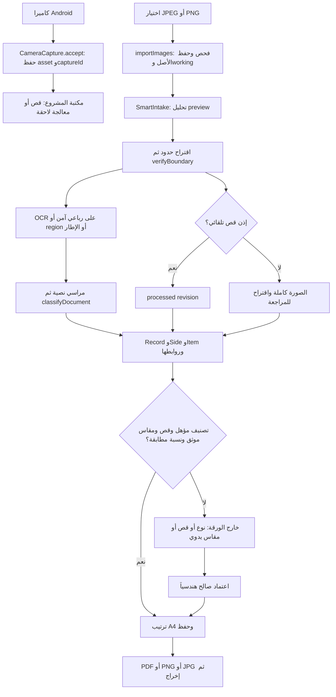
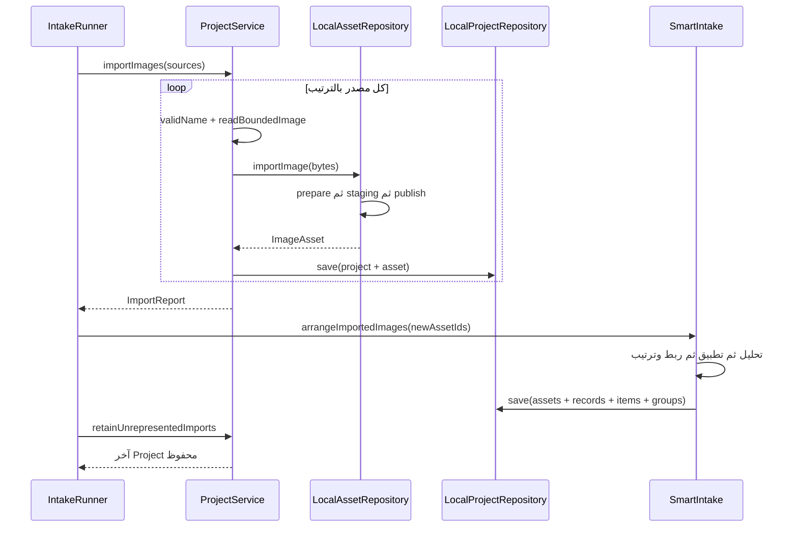
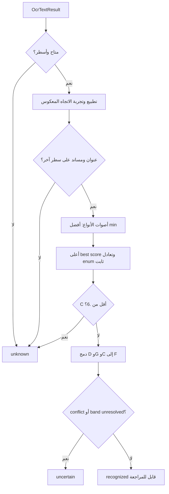
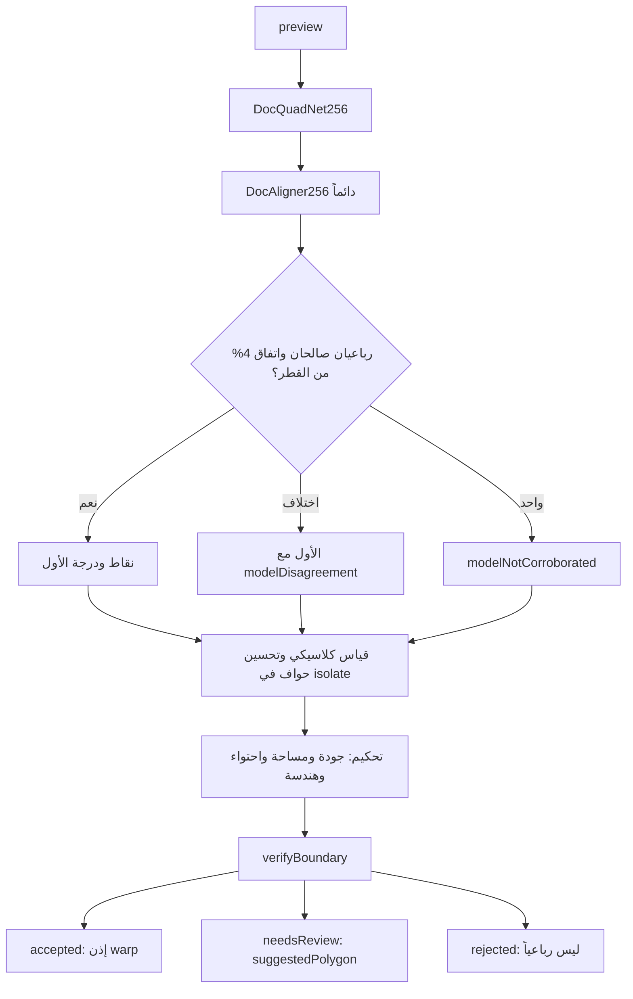
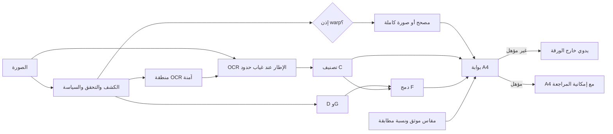
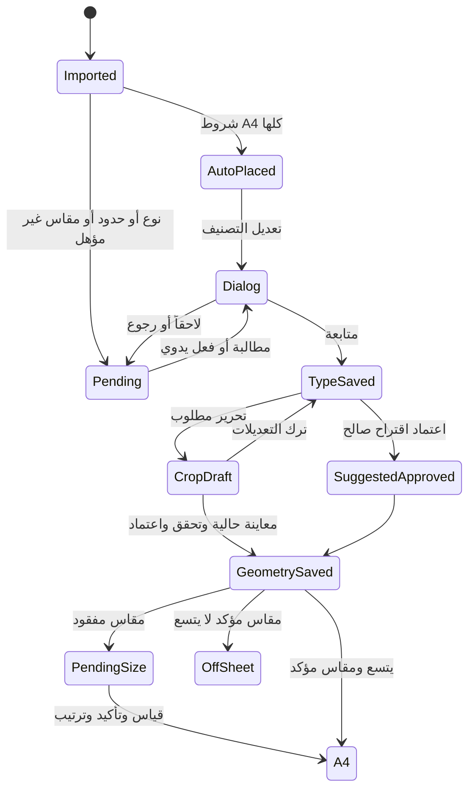
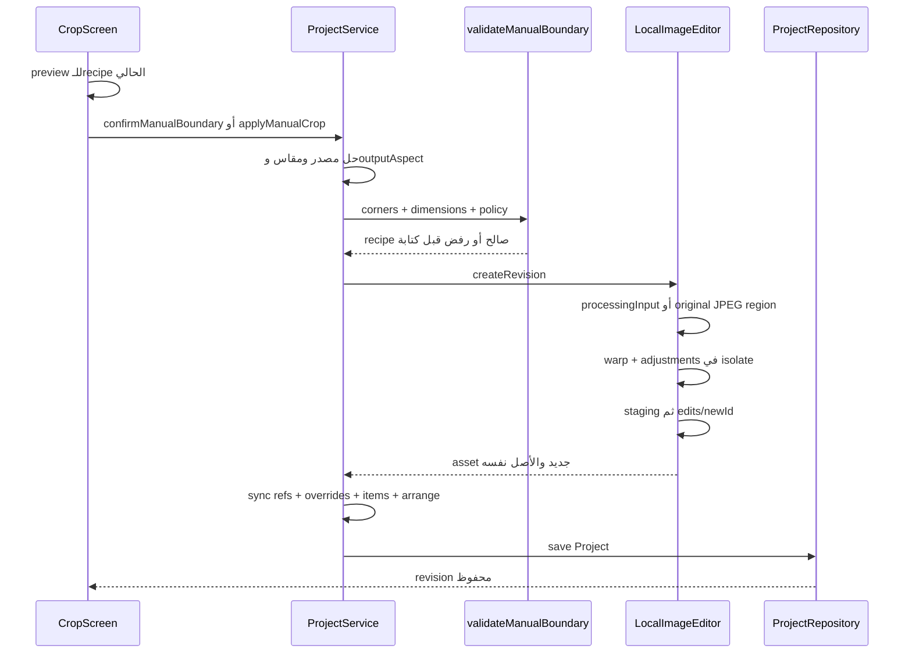
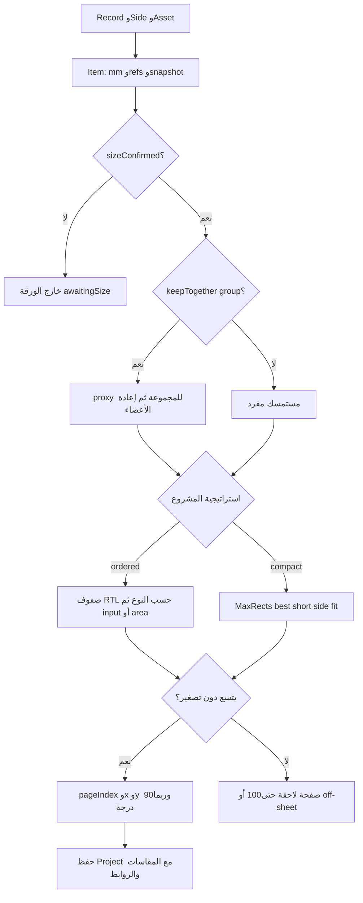
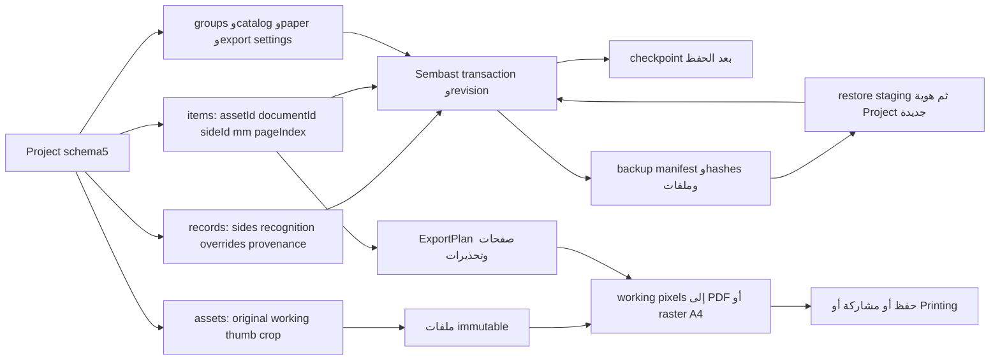

# تدقيق دورة حياة المستمسك في Scan-id

**التاريخ:** 2026-11-09 UTC. **المهمة:** است جواب وتحليل وتوثيق فقط؛ لم تعدّل خوارزمية أو عتبة أو كود تطبيق.

> أرقام الأسطر تخص أساس التطبيق `d8058755705ef234f9a1995e309265d63ee2cc95`. «مثبت بالكود» لا يعني تجربة جهاز. «مثبت بالاختبار» محجوز لما نُفذ فعلاً بهذه الجلسة؛ اختبارات Dart المذكورة **موجودة وغير منفذة**. «غير محسوم» يعني نقص دليل. لم تصل صور مستمسكات أو لقطات واجهة مرفقة قابلة للوصول في رسالة المهمة الحالية؛ لذلك لم تُجر مقارنة بصرية معها. لم نعتمد التقارير التاريخية بديلاً عن قراءة التنفيذ الحالي.

## 1. الملخص التنفيذي

- التطبيق Flutter محلي لـ Android و Windows، بطبقات domain/application/imaging/persistence/presentation/export. الأصل منفصل عن working PNG والمصغرة ووصفات التحرير، و A4 يتعامل مع مراجع ومقاسات مليمتر ية.
- **Smart Recognition مفعل في التطبيق** (`lib/main.dart:129–147`)، رغم أن default إنشاء `ProjectService` مباشرة false؛ تقسيم عدة مستمسكات من صورة واحدة غير مفعل افتراضياً. لا تساوِ مسارات الاختبارات المحقونة بمسار الإنتاج.
- التصنيف الحالي **نصي فعلاً**: PP-OCRv5 عربي عبر ONNX، عنوان مميز ومرساة على سطر مختلف. لا تصويت من filename أو shape. خمسة أنواع بقواميس: الوطنية، الأحوال، السكن، التموينية، الجواز؛ لا فئات مصرف/دفع/موظف أو مصنف كتابة يدوية (`domain/ocr_evidence.dart:113–184`، `recognition_classifier.dart:89–172`).
- إذن القص مستقل عن نجاح OCR والنوع؛ لكن **الوضع التلقائي على A4** يشترط أيضاً تصنيفاً مؤهلاً ومقاساً موثقاً وتوافق النسبة ضمن 4% وقصاً منفذاً (`recognition_pipeline.dart:492–640`، `smart_recognition.dart:1977–2008`).
- العتبة المركزية **70%** وليست 55–60%. وهناك .6 لإسقاط النوع إلى unknown، .5 لأرضية المكونات، .7/.9 للتوجيه، .3/.6 لكشف النص. المقاييس غير معايرة ولا تمثل دقة.
- الحدود تجمع DocQuadNet ثم DocAligner، وتحكيم/تحسين كلاسيكي. غياب الرأي الثاني أو الاختلاف يقتضي مراجعة؛ الكلاسيكي يبقى review-only. صلاحية الرباعي ليست إثبات تطابقه مع حدود المستمسك الفيزيائي.
- دعم الوجهين موجود كبيانات وقص مستقل وربط يدوي ومجموعة متجاورة. المسار المعتاد **سجلان مرتبطان**، لا دمج تلقائي للوجه الثاني في السجل الأول؛ لا استخراج معرف مشترك أو قاموس front/back.
- خطر مثبت مهم: **التأكيد اليدوي يفرض نسبة المقاس المختار على pixels الناتجة** (`project_service.dart:1275–1290`). ضمان contain في A4 لا يمنع تشويه اً حدث سابقاً أثناء warp.
- الصور تحفظ قبل records/items؛ الانقطاع قد يترك asset بلا تمثيل أو ملفات يتيمة. توجد وسائل استرداد وصيانة، وليس transaction ذرية تشمل الملفات والـ DB.
- Flutter/Dart غير متاحين محلياً؛ analyze/test لم ينفذا. نجحت أربعة فحوص Python ساكنة. اكتشاف اختبارات الأدوات نفذ 38 حالة وانتهى بخطأ import واحد لغياب Pillow. لا ادعاء بدقة OCR أو الكشف أو طباعة فعلية.

## 2. معلومات المستودع والفرع والـ Commit

| الحقل | النتيجة المثبتة بالأوامر |
|---|---|
| المستودع | `kinanmjeed88/Scan-id` |
| عنوانه و origin | https://github.com/kinanmjeed88/Scan-id — `https://github.com/kinanmjeed88/Scan-id.git` |
| المسار | `/home/user/Scan-id` |
| الفرع | `arena/b8482be0-scan-id` |
| أساس التطبيق | `d8058755705ef234f9a1995e309265d63ee2cc95` |
| Git قبل العمل | `git status --short` فارغ؛ لا تغييرات محلية سابقة |
| فرع الرفع | فرع الجلسة نفسه؛ بيئة Arena تثبت اسمه، لذلك لم ينشأ فرع آخر باسم audit/... |
| التطبيق | `scan_id`، version `0.1.2+3` (`pubspec.yaml:1–5`) |
| SDK المطلوب | Dart `>=3.9.0 <4.0.0`، Flutter `>=3.35.7` (`pubspec.yaml:7–9`) |
| SDK المحلي | غير مثبت في PATH؛ لا إصدار قابل للإثبات |
| CI | Flutter3.35.7 stable (`.github/workflows/verify.yml:84–90`) |

الحزم المباشرة (`pubspec.yaml:11–40`): file_selector1.0.3، image4.5.4، path1.9.1، path_provider2.1.5، sembast3.7.2، pdf3.12.0، printing5.14.3، crypto3.0.7، url_launcher^6.2.4، flutter_lints5.0.0. flutter_onnxruntime مثبت على Git ref `2f0fc6c102652965004b89512b7187e6621dddf7`. الحل المحفوظ في `pubspec.lock`؛ هذه ليست حزم تم تحميلها في هذه الجلسة.

البنية: `lib/{domain,application,imaging,persistence,presentation,export,reference_annotation}`، `android`، `windows`، `assets`، `test`، `integration_test`، `tool`، `design`، `docs`، `.github/workflows`. لم يُعثر على دليل في الكود الحالي على هدف منتج ويب أو iOS بهذا checkout؛ `dart:io` والجسور native يحتاج ان تكييف اً للنقل.

## 3. المعمارية العامة

- `main()`→`_Bootstrap/_openStorage` (`lib/main.dart:33–151`): جذر LocalAppData على Windows أو ApplicationSupport، ثم Sembast و repositories و editor/camera/recovery/backups.
- Widgets عربية و`LayoutEditorController` و`LayoutSession` لإدارة Project والاختيار والأوامر/undo؛ لا Bloc/Provider بالاعتماديات المباشرة (`presentation/editor_controller.dart:38–100,181–230`).
- `ProjectService`: واجهة الأوامر؛ `IntakeRunner`: نسخ ثم تحليل/ترتيب وتعافي؛ `SmartIntake`: تحليل وتطبيق وربط وترتيب وحفظ. `RecognitionPipeline` **تحليل بلا كتابة ملفات** (`application/recognition_pipeline.dart:1–9`). عقود `application/contracts.dart` تفصل التنفيذ.
- domain pure Dart: قواعد النوع والمقاس والرباعي والثقة والتخطيط ومخطط المشروع؛ imaging: decoding/ONNX inputs/edges/perspective.
- persistence: صور immutable و metadata/revision/checkpoints/backups؛ لا قاعدة نص OCR. export: ExportPlan→DocumentExporter في isolate→OutputService→المنصة.

**اليقين: مثبت بالكود** في نقاط التركيب والمسارات المذكورة، لا قياس لزمن الاستجابة أو ثبات منصة.

## 4. خريطة الملفات والمكونات ذات الصلة

المسارات المختصرة لاحقاً تحت `lib/` ما لم تبدأ بمجلد آخر.

| المسؤولية | الملف والدالة/المكوّن والأسطر | الأثر |
|---|---|---|
| التركيب والاختيار | `main.dart:76–165` `_openStorage/_pickImages` | يحدد السياسة المشحونة |
| الاستيراد والتعافي | `application/project_service.dart:317–534` `importImages/arrangeImportedImages/retainUnrepresentedImports` | أصل أولاً ثم تمثيل |
| تنسيق UI | `presentation/intake.dart:101–293,329–467` `IntakeRunner.run` | تقدم وإلغاء وتعافي |
| معالجة النتائج | `application/smart_recognition.dart:177–514,1385–1559` `run/_analyzeImages/_applyImage` | records/items/revisions |
| OCR والنوع | `application/recognition_pipeline.dart:428–660`؛ `paddle_ocr_engine.dart:162–345`؛ `domain/ocr_evidence.dart:113–306` | أدلة نصية وتوجيه |
| قرار النوع | `domain/recognition_classifier.dart:65–237` | فوز/تعارض/دمج/أهلية |
| حدود | `imaging/{docquad_model,docaligner_model,boundary_proposal_cascade,boundary_arbitration,document_detector}.dart` | تعلم وكلاسيكي |
| هندسة/إذن | `domain/boundary_decision.dart:281–419`؛ `quad_assessment.dart:74–165` | قبول/مراجعة/رفض |
| يدوي | `presentation/{manual_classification_dialog,layout_screen,crop_screen}.dart` | نوع/وجه/قص/اعتماد |
| حفظ القص | `application/project_service.dart:1153–1454`؛ `persistence/local_image_editor.dart:200–337,390–459` | revision مستقل |
| مقاس | `domain/document_kind.dart:249–365`؛ `document_edits.dart:36–167` | المليمتر والتأكيد |
| وجهان | `domain/manual_classification.dart:125–218`؛ `recognition_overrides.dart:153–245`؛ `side_pairing.dart:64–173` | ربط متبادل ومجموعة |
| A4 | `domain/arrangement.dart:139–318,703–1000`؛ `packing.dart:25–178` | rows/MaxRects |
| استمرار ية | `persistence/{local_project_repository,local_asset_repository,safe_files,recovery_checkpoints,local_project_backups}.dart` | ملفات و DB وتعافي |
| إخراج | `domain/export_plan.dart:7–79`؛ `export/document_exporter.dart:38–295`؛ `application/output_service.dart:48–131` | حفظ/مشاركة/طباعة |

فهرس `document_lifecycle_evidence_index.md` المرافق يميز الجرد الآلي للملفات عن القراءة المتعمقة؛ لا يعني جرد اسم اختبار تشغيله.

## 5. مخطط دورة حياة المستمسك بالكامل

الاستيراد الضيق ينتهي عند `ImportReport` بعد حفظ الصور (`project_service.dart:412–418`)؛ دورة المستخدم تنتهي بعد `IntakeRunner.run` بالترتيب وتعافي غير الممثلين (`presentation/intake.dart:192–293`). الكاميرا مسار مختلف لا يجوز افتراض مروره تلقائياً بـ SmartIntake.

## 6. آلية الاستيراد

### المصادر والصيغ

`_pickImages` يختار ملفات متعددة على Windows عبر openFiles (jpg/jpeg/png)، و Android `pickAndroidImages` عبر`iq.scanid/local_documents` بـ image/* و multiple=true و 20MiB (`main.dart:153–165`، `application/native_documents.dart:66–83`). Android قد يعرض صيغاً أوسع من decoder؛ التحقق النهائي من المحتوى لا الاسم.

`readBoundedImage` يجمع stream بسقف bytes؛ `decodeForProcessing` يفحص header قبل pixel allocation، JPEG/PNG فقط، يرفض PNG المتعدد/التالف، يطبع القنوات ويعالج EXIF (`application/image_reader.dart`، `imaging/prepare_image.dart:26–70`، `image_header.dart`). لا استيراد PDF/HEIC/TIFF مثبت.

الحدود (`domain/image_limits.dart:1–42`):20MiB، direct16MP، JPEG مصدر≤32MP يصغر إلى working≤4MP، preview طويل≤1200 وقصير≥40، project≤200asset و 500item. PNG الكبير ليس sampled-JPEG path (`local_asset_repository.dart:83–118`، `imaging/large_jpeg_plan.dart`).

`LocalAssetRepository._import` يولد ID عبر newId، يكتب staging ثم rename إلى`projects/<projectId>/assets/<id>`: أصل كما هو،working.png،thumb.jpg (`local_asset_repository.dart:129–165,206–240`). السجل اللاحق `rec-<itemId>` والوجه`side-<itemId>` والكشف`<assetId>-d0` (`smart_recognition.dart:2113–2151`، `recognition_pipeline.dart:399–413`).

النسخ تسلسلي (`project_service.dart:337–410`)، worker قابل للتوازي لكن **defaultConcurrency=1** (`recognition_worker.dart:61–71,109–139`)، التطبيق تسلسلي بترتيب المدخلات (`smart_recognition.dart:214–285`).

كل صورة تحفظ مستقلة. الإلغاء قبل المصدر التالي لا يتراجع عما حفظ، ويذكر الباقي ك failures؛ RevisionConflict يوقف الاستيراد لتجنب أيتام إضافي ين؛ finally ينظف نسخة picker المؤقتة لا الأصل (`project_service.dart:337–410,1750–1760`، `native_documents.dart:123–140`).

نافذتا انقطاع مثبت تان: publish الملفات قبل DBsave قد يترك ملفاً يتيماً؛ DB يحفظ asset قبل record/item وقد يبقى غير ممثل بعد قتل العملية. `retainUnrepresentedImports:479–534` ينشئ unknown/off-sheet لما يعرفه من imported IDs؛ **ليس دليلاً على ماسح بدء شامل لكل انقطاع**. SmartIntake يجمع قوائم كل صورة ثم يدمج الناجح ويحفظ المراجع معاً؛ revisions المنشورة قبل save قد تصبح يتيمة (`smart_recognition.dart:233–241,353–379`). reprocess صريح يحاول حفظ الهوية و Overrides، لا retry تلقائياً غير محدود (`project_service.dart:284–315`، `smart_recognition.dart:546–869`).

### الكاميرا

Android فقط من compositionroot (`main.dart:125–127`)، تطبيق النظام ACTION_IMAGE_CAPTURE/EXTRA_OUTPUT (`android/app/src/main/kotlin/iq/scanid/scan_id/NativeCamera.kt:40–80`)، لا preview scanning آني. `CameraCapture.accept:37–65` يعيد تحميل Project، يمنع تكرار captureId، يحفظ asset ثم discard best-effort للإيصال. `_camera` (`project_screen.dart:173–197`) **لا يستدعي arrange/SmartIntake**، بل رسالة أن الأصل حفظ ويمكن القص؛ pending capture له معاينة وحوار استعادة (`217–280`). يمكن إذن حفظ صورة دون record/item بهذا المسار. هذا مثبت بالكود، لا افتراض من وجود زر.

## 7. آلية OCR والتعرف على النوع

### المحرك والمراحل

PP-OCRv5 mobile DB detection + Arabic CTC recognition عبر flutter_onnxruntime، لا MLKit/Tesseract في المسار. نسخته ومساراته ومراجع أوزانه بـ`application/ocr_model_assets.dart:10–36`، تركيبه`main.dart:146`.

1. `prepareOcrRegionIsolated`: authorized quad، أو اقتراح هندسي صالح ولو review، أو region؛ كامل الصورة في singleton fallback؛ isolatedRegion بلا حدود/region آمنة يتخطى OCR لمنع نص الأشقاء (`recognition_pipeline.dart:547–586`).
2. detectiontensor BGR NCHW، ضلع 960 ومحاذاة 32 وتطبيع mean/std (`imaging/ocr_tensor.dart:30–50,80–126`).
3. native detection→`decodeTextBoxes`: connectedcomponents8، bitmap≥.3، متوسط box≥.6، minimumarea rotatedrectangle ونمو area*1.5/perimeter وترتيب القراءة (`db_text_boxes.dart:8–18,31–42,83–170`). هذه **حدود نص** لا مستمسك.
4. ≤32 سطر، tensor سطر 48px ارتفاع ومحاذاة 8 حتى 960 عرض؛ sampling دون bitmaps وسيطة لكل سطر (`ocr_tensor.dart:36–44,129–170`، `paddle_ocr_engine.dart:237–242`).
5. recognition بالتتابع و greedyCTC (blank/repeats، softmax عند logits، dictionary Unicodecodepoints)، إسقاط سطر إذا confidence<.3 (`ocr_decoding.dart:35–59,68–123,132–220`، `paddle_ocr_engine.dart:248–296`).
6.25 ثانية budget داخلية؛ يعيد partiallines عند الانتهاء، أو unavailable/empty بصدق؛ pipeline يواصل دون أدلة عند الفشل/timeout (`paddle_ocr_engine.dart:49–60,298–307`، `recognition_pipeline.dart:587–629`).

المحرك/القاموس يستطيع تمثيل العربية واللاتينية والأرقام، و inference tests ترسم هذه النصوص اصطناعياً؛ **لم تنفذ هنا**. لا MRZparser أو identifier extraction أو تحقق أرقام مصرفية في المصنف. لا خط يد متخصص مثبت. النص الخام لا يخزن/يسجل؛ فقط مشتقات درجات ومجموعات مراسي (`ocr_evidence.dart:1–6`، `recognition_classifier.dart:101–112`).

### التطبيع والقواعد والثقة

`_normalize:186–199`:lowercase، إزالة التشكيل والتطويل، توحيدأ/إ/آ/ٱ،ؤ/ئ،ة→ه،ى→ي،ك/يالفارسية، إزالة المسافات/الترقيم مع إبقاء العربية/اللاتينية/الأرقام. `_hits:215–241` يجرب السطر ومعكوس runes لدعم logical/visualArabic؛ substring ثابت لا fuzzy/learning. الأرقام وحدها لا تصوت للنوع.

يلزم primarytitle ومساند من مجموعة أخرى **على سطر مختلف**. درجة الدليل لأفضل زوج=`max_pairs(min(conf_title, conf_support))`، ليست احتمالاً معايراً؛ كثرة المراسي لا ترفعها آلياً (`249–306`). كل المراسي التالية موجودة حرفياً بعد التطبيع:

| النوع | الأدلة النصية المستخدمة | قواعد التصنيف | درجة الثقة | شروط القبول |
|---|---|---|---|---|
|unifiedNationalId|عنوان: البطاقهالوطنيهالموحده،البطاقهالوطنيه،بطاقهوطنيه،nationalcard،nationalid؛ رقم: الرقمالوطني،رقمالبطاقه،nationalnumber،idnumber؛ جهة: وزارهالداخليه،مديريهشؤونالبطاقهالوطنيه|primary+identifier أو issuer بسطر آخر (`113–129`)|أفضل minimum لثقتي السطرين|C≥.6 لا unknown؛ للوضع الآلي C/F≥.7 وبقية البوابات |
|civilStatusId|عنوان: هويهالاحوالالمدنيه،بطاقهالاحوالالمدنيه،هويهالجنسيه،civilstatusidentity؛ سجل: سجلالنفوس،رقمالسجل،رقمالصحيفه،civilregistry؛ جنسية: الجنسيه،nationality|primary+registry أو citizenship (`130–144`)|نفسها|يمكن تصنيفها،لا مقاس كتالوج فلا وضع آلي مكتمل |
|residenceCard|عنوان: بطاقهالسكن،هويهالسكن،بطاقهسكن،residencecard؛ عنوان سكن: المحله،الزقاق،رقمالدار،رقمالعقار،residentialaddress؛ جهة: مديريهالبلديه،بلديه|primary+address أو issuer (`145–160`)|نفسها|مقاس estimated يحتاج تأكيداً يدوياً |
|rationCard|عنوان: البطاقهالتموينيه،بطاقهتموينيه،rationcard؛ جهة: وزارهالتجاره،ministryoftrade؛ تفاصيل: الوكيلالتمويني،المركزالتمويني،الحصهالتموينيه،rationcenter|primary+issuer أو rationDetails (`161–174`)|نفسها|مقاس تقديري وملاءمة A4 مستقلة |
|passport|عنوان: جوازالسفر،جوازسفر،passport؛ رقم: رقمالجواز،passportno؛ بيانات: dateofbirth،nationality|primary+documentNumber أو personalDataLabels (`175–183`)|نفسها|C/F≥.7،نوع وحيد،حدود/قص/توافق TD3 |
|unknown/other|لا مراسي|unknown غياب/ضعف الدليل؛other يدوي|لا درجة مخترعة|لا تعرف آلي للفئة العامة |

**القواعد مثبتة بالكود؛ دقة كل نوع غير محسومة.** الجهة/اسم الدولة وحدهما لا يكفيان. لا أنواع مصرف/دفع/موظف مخفية نضيفها للجدول.

التعارض إذا votes>1 وفرق أعلى درجتين<.15 (`recognition_classifier.dart:114–136`). المتوسط الهندسي`exp(sum(w*ln(clamp(v,1e-6,1)))/sum(w_available))` يستبعد absent لا يحسبه صفر (`recognition_routing.dart:81–106`). C أوزانه aspect.4/OCR.3/structure.3 **لكن المتوفر حالياً OCR فقط**، فيساوي درجة الدليل النصي؛ F أوزانه D.2/G.3/C.5. متوسط OCR لجميع الأسطر محفوظ منفصلاً ولا يدخل في F مرة ثانية (`recognition_classifier.dart:151–172,206–232`).

## 8. آلية اكتشاف الحدود واحتساب الثقة

DocQuadNet:letterbox256 و RGB، heatmaps64×64،peaks وإسقاط offset/scale، حد.05 لأدلة المراجعة؛ degree=IoU بين قناع النموذج ومضلع الزوايا × أدنى peak لأربع زوايا و.7 للآلي (`docquad_model.dart:37–41,116–167,200–260`). DocAligner:resize256 مباشر BGR،centroid أكبر component فوق.3 لكل زاوية،degree=أدنى peak و.7 للآلي (`docaligner_model.dart:29–31,126–166,190–288`). scores غير معايرة،لا.7 يعني 70%زوايا صحيحة.

Cascade:نموذجان بالتتابع؛ max correspondingcorner displacement/image diagonal؛ >.04 اختلاف،يحفظ الأول بلا averaging؛واحد review،لاواحد null (`boundary_proposal_cascade.dart:35–95,118–148`). **الـ corroboration لا يشترط score الثاني≥.7**؛ `_usable` يستعمل hasUsableGeometry لا accepted؛ درجة الأول تبقى حاكمة. هذه حقيقة policy لا قياس خطأ على صور.

`LocalImageEditor.suggestProposal:114–162` يقيس الكلاسيكي دائماً ثم arbitrate؛ ليست منظومة AI فقط. الكلاسيكي (`document_detector.dart:104–151,278–280,465–550`):coarse480/fine1200،structuretensorgradients لونية،blurbinomial،مرشح segmentation خلفية/Otsu و Hough موجه،edge support/strength وتباين داخل/خارج وعقوبة texture،rerank حدة حواف وتحسين subpixel وخطوط متقاطعة. `runScored:475–509`:p75/p90،high=max(12,p90)،low=max(3,.45*high*sensitivity)،texture<30 و area<.985؛pass1(1,.5,.3) و pass2(.5,.7,.5)،الثاني يفوز إذا فارق score>.04 (`104–122`).

جودة المقارنة `Q=.6*meanSupport+.4*minSupport`،looksLikeBoundary=mean≥.5 و min≥.3 (`document_detector.dart:1482–1508`). التحكيم (`boundary_arbitration.dart:69–148,261–427`):refine≤.04 قطر ولا يقل Q،agreement<.04 يحفظ flags،استبدال كلاسيكي يحتاج area≥.05 وحواف الأضلاع وعدم frame-touch.016 وصلاحية ومنطقة/نسبة إنادعيت؛لايفوز innerframe أشد gradient إذا كان داخل quad المتعلم،ولا يصغر القص بقوة gradient وحدها؛qualitymargin.10. فوز الكلاسيكي review-only.

توجد قواعد مقاومة texture والظل،لكن **لم يُعثر على دليل في الكود الحالي** على ضمان الخلفية نفس اللون أو نموذج glare-removal أو تصحيح انعكاس مرآتي دلالي. ضعف الإضاءة/الانعكاس قد يقلل الأدلة؛ المعدلات غير مقاسة.

| القياس | القيمة/المعادلة | المصدر والمعنى |
|---|---|---|
|normalized quad|4finitepoints0..1،convex/winding،مساحة غير منها رة،homography غير مفرد|`geometry.dart`واستدعاء`quad_assessment.dart:79–109` |
|مساحة تلقائية|area/frame≥.02|`quad_assessment.dart:111–116` |
|ضلع|≥4px|`117–124` |
|أضلاع ضدية|max/min≤2.5|`125–130` |
|aspect|long/short≤12|`131–136` |
|A زاوية|min clamp(1−abs(angle−90)/45,0,1)|`137–151` |
|E أضلاع|clamp(1−(max(oppositeRatios)−1)/1.5,0,1)|`152–154` |
|S مساحة|clamp(areaFraction/.15,0,1)|`155–156` |
|G جودة هندسية|.5A+.3E+.2S|`157–165`؛لا معرفة نوع |
|إذن learned|finite0..1 و≥.70 وكل أسباب المراجعة فارغة|`boundary_decision.dart:385–418`،`acceptance_policy.dart:3–12` |
|تماس إطار|x/y≤.016 أو≥.984 للـ learned بلا region|`boundary_decision.dart:385–392` |
|اتفاق region|المركز داخلها وتداخل boundingboxes|`356–382` |
|imposedaspect اختياري|max(measured,imposed)/min≤2.5|`346–353`؛لا يمر ره kind في pipeline الحالي |
|توافق A4|abs(measured/catalog−1)≤.04|`smart_recognition.dart:1999–2008` |
|هندسة يدوية|ضلع≥4px،area≥16px²ونسبة≥.002،convex/no crossing/invertible|`manual_boundary.dart:24–33,98–241` |

عند نقص زاوية لا اعتماد بثلاث؛null/review/rejected والأصل باقٍ وأدوات أربع نقاط. اقتراح review يحفظ suggestedPolygon مستقلاً عن polygon المعتمد (`recognition_pipeline.dart:518–545`،`smart_recognition.dart:2193–2217`).

## 9. العلاقة بين التصنيف والكشف

**مستقلان في إذن القص، مترابطان في اختيار منطقة OCR وفي F وأهلية A4.** verify قبل OCR ولا يمرر kind (`recognition_pipeline.dart:492–517`). OCR قد يستخدم رباعياً صالحاً هندسياً ولو review (`555–565`).

| السؤال | الجواب والدليل |
|---|---|
|تصنيف دون حدود ناجحة؟|نعم كامل singleton أو region/اقتراح review؛لا يثبت مقاساً (`547–586,633–646`) |
|حدود دون نوع؟|نعم قرار ها بدون kind (`492–517`) |
|فشل OCR يرفض حدوداً صالحة؟|لا،issue/unavailable ومتابعة (`593–629`) |
|D/G تؤثرفي C؟|لا تصوت للنوع؛تؤثرفي F/التوجيه (`recognition_classifier.dart:151–185`) |
|رباعي صالح هندسياً يكفي؟|لا؛policy للدرجة/frame/forceReview،لكن ضعف النص ليس سبباً |
|reviewAll يمنع crop/A4؟|لا،خاص بقائمة مراجعة record (`recognition_routing.dart:37–46`) |

`qualifiesForAutomaticPlacement:65–83`:recognized،kind≠unknown،candidates.length1 يطابق النوع،C/F≥.7،المكونات الموجودة ضمن[.5,1]. حتى مرشحان فرق هم كبير ولا يعد ان conflict يمنعان الوضع الآلي. `_confirmedCatalogSize`يضيف موثق الحجم وقصاً وتوافق نسبة. خفض.7 وحده لا يلغي unknown أو unresolved أو missing-size.

## 10. التصنيف اليدوي ومسارات الفشل

القائمة ثابتة`reviewKindChoices`في`presentation/review_screen.dart` من enum،لا fetch أو نتائج OCR؛ Dropdown يبنى منها (`manual_classification_dialog.dart:225–237`). front/back/unknown،unknown افتراضي صالح (`61–85,240–263`).

1. controller بعد الاستيراد يجمع newitemsoff-sheet غير مؤكدة وغير locked،لا unknown وحده (`editor_controller.dart:844–853`). مسار شاشة المشروع يقود إلى التخطيط/المعلق ات (`project_screen.dart:100–153`). تعديل تصنيف المحدد صراحة ولو نجح التلقائي (`layout_screen.dart:194–198`).
2. حوار non-barrier-dismissible يعرض thumbnail/اسم/نوع/وجه/شريك،وتفاصيل أسباب ودرجة حدودو C و F منفصلة اختيارية (`manual_classification_dialog.dart:100–218`). لا transcript لأنه غير محفوظ.
3. متابعة تحتاج kind و side غير null فقط؛sideunknown الافتراضي كافٍ؛لاحد confidence يدوي. لاحقاً يعيد null وينهي الحلقة ولا يمسح الصورة (`294–321`،`layout_screen.dart:223`).
4. `classifyItemManually:14–120`يحفظ أولاً نوعاً ووجهاً بـ Overrides؛ينشئ manualrecord إذا fallback بلاسجل،لا detector مزيف. تغيير نوع/وجه زوج يفكالربطمتناظراً (`74–78`).
5. إن لم يتأكد المقاس:checkbox«اعتماد الحدود المقترحة»مفعل افتراضياً عند صلاحيتها؛confirmSuggestedBoundary→confirmManualBoundary دون محرر أو إعادة OCR (`layout_screen.dart:244–266`،`project_service.dart:1205–1237`). وإلا CropScreen؛ editingExisting مع approvedcrop قد لا يعيد فتح القص (`264`).
6. لامقاس:يحفظ النوع/القص ويبقى off-sheet. estimated يمكن إقرار default يدوياً. الشريك يُربط فقط بعد sizeConfirmed (`layout_screen.dart:273–292`).
7. إلغاء crop يبقي التصنيف المحفوظ قبله،لا draft غير المعتمد؛ ليست معاملة إلغاء واحدة لكل الخطوات. تبقى الأدلة المشتقة والكشف،ولا re-OCR إجباري؛reprocess فعل صريح مع حماية Overrides (`smart_recognition.dart:546–869`،`recognition.dart:612–669`). لا تعلم من التصحيح.

## 11. المقاسات والتحويلات الهندسية

| النوع | الطبيعي مم | مصدره في الكود | التحفظ |
|---|---|---|---|
|الوطنية|85.6×53.98|documented/standard،ISO/IEC7810:2019 ID-1 (`document_kind.dart:255–264,332–333`)|الكود يعترف بعدم مراجعة وثيقة جهة إصدار عراقية للمطابقة |
|الجواز|125×88|documented/standard،ICAO9303 TD3 (`266–272,335–336`)|صفحة بيانات لا جواز مفتوح |
|السكن|92.4×62.8|estimatededitable (`274–280,338–339`)|افتراضي غير رسمي |
|التموينية|52×287|estimatededitable (`282–288,341–342`)|ورقة portrait،لا يعمم على كل الإصدارات |
|الأحوال|لايوجد|missing (`290–295,353–360`)|قياس يدوي |
|other/unknown|لايوجد|missing (`297–300,353–360`)|لا قياس مخترع |

الأرقام في DocumentSizeCatalog؛السياسة في documentSizeRecords. sizeFor يقلب الاتجاه حسب القص ولا ينشئ نوعاً (`351–365`). customvariants موجودة لكن لا تضيف lexicon آلياً.

mm وحدة layout/print،pixels للصور ةو normalizedcorners؛ `millimetersToPixels=mm*dpi/25.4`والعكس (`geometry.dart:6–17`)،PDFpoints=mm*PdfPageFormat.mm (72/25.4). لا استنتاج mm من كاميرا غير معايرة؛ provisionalSize تقدير واجهة لا تأكيد (`smart_recognition.dart:1494–1496,2319–2338`).

`validDocumentSize`:كلا البعد ين 10..400mm (`document_kind.dart:64–79`). `DocumentEdits.resize:137–167`يسمح بتغيير بعد واشتقاق الآخر مع keepAspectRatio أو تحرير الاثنين؛يجعل unknown→other و sizeConfirmed و snapshot. تغيير النوع يطبق catalog مؤقتاً؛standard لا يتأكد بمجرد النوع بدون approvedcrop،estimated يحتاج إ قراراً (`document_edits.dart:24–113`). يمكن حفظ مستمسك بلا مقاس مؤكد،لكن خارج A4.

**ملاءمة مثبتة حسابياً:** A4portrait بهوامش 10→190×277؛default التموينية 287>277 فلا يلائم حتى الدوران داخل 190×277. يبقى off-sheet بلا auto-scale؛يجب مراجعة القياس/الهوامش صراحة،وليس فشل OCR (`project.dart:23–24,78–84`،`arrangement.dart:44–89`).

## 12. القص اليدوي والتلقائي

`CropScreen._load:436–538`يقرأ preview ويستخدم approvedcrop المحفوظ أو inspectSuggestedBoundary؛كامل الإطار ليس اعتماداً،غياب الاقتراح manualRequired. draft/history يشمل kind/size/adjustments؛أي change يبطلال preview القديم.

العرض (`crop_screen.dart:1480–1601`):preview بنسبة source وبـ inset للمقابض،CustomPainter،InteractiveViewer1..5،نتيجة contain. الإحداثيات`globalToLocal`على RenderBox ثمقسمة width/height و clamp0..1،فتشمل transform (`1666–1677`). visualhandles ثابتة بعد zoom،cornerhit32px/edge18px (`1791–1836`،`boundary_handle.dart`).

- سحب corner واحدة أو edge بنقطتي نو deltaincremental؛أول updateanchor فقط،anchor يتقدم حتى الخطوة المرفوضة لمنع jump (`1680–1709`).
- `quadEdgesCross`أثناء السحب يمنع التقاطع ويحفظ آخر شكل؛الفحص الكامل convex/area/homography لاحقاً (`1710–1732`،`manual_boundary.dart:165–241`).
- tapmode حتى أربع نقاط مع minseparation و canonicalTL/TR/BR/BL،يقبل ترتيب نقرتقاطعي إذا المجموعة convex (`manual_quad_selection.dart:32–78`،`crop_screen.dart:1614–1665`).
- `CropPrecisionLoupe`يعرض preview نفسه عند السحب،ليس تحميل full-density مستقلاً (`1567–1590`،`presentation/crop_loupe.dart`).
- BoundaryHitLayer لكل pointerrecognizer ولا يلتهم pan في المناط فالخالية (`boundary_hit_layer.dart:121–153,174–199`). **لكن** CropScreen يشارك`_activeDragHandle/_dragLastLocal/_cornerDragMoved`ويستبدلها كل onDragStart (`1798–1834`)،فلا يثبت صحة سحب ضلع ينمتزامنينو undo/loupe لهما؛يلزم اختبار جهاز،الخلل النهائي غير محسوم.
- `_accept:1115–1206`يحتاج preview/recipe حاليين و source و manualRequired=false ويتحقق size قبل كتابة غير قابلة للإلغاء. `_leave:1209–1235`يطلب تجاهل dirtydraft ويبقي الأصل وآخر معتمد.

اعتماد الاقتراح مباشرة يمر بنفس confirmManualBoundary والتحقق الهندسي؛هو **قرار مستخدم** لوقامت AI بالنقاط،لا ترفع درجته بصورة مصطنعة (`project_service.dart:1205–1237`).

## 13. المعالجة النهائية للصورة

`CropDraft.toRecipe:67–119`:متوسط الضلع ينالمت قابلين+1 لكلبعد؛ratio صريح ينقص أحد البعد ين ولا ينشئ دقة فوق التقدير؛freecrop يحاول`estimatePhysicalAspect`: `f²=−(v1−o)·(v2−o)` ثم`W/H=norm(K^-1*g0)/norm(K^-1*g1)`،focal.25..4 من الضلع الطويل و aspect.1..10؛إذا غير محدد fallback لمتوسطالأضلاع (`physical_aspect.dart:1–35,55–102`). افتراض pinhole/مركز صورة/squarepixels؛لاقياس mm ولا ضمان نسبة واقعية بكل الميل.

PerspectiveMap/warpPerspective:projectiveunitsquare→sourcequad،inversesampling بـ bilinear و premultipliedalpha؛brightness/contrast/saturation/sharpness ثم rotation (`imaging/perspective.dart:13–175`وما يلي ها). preview نفس mapping/recipe بعدد pixels أقل. outputPNG ومصغرة JPEG320quality82 (`local_image_editor.dart:390–454`)،حد output16MP. CPU/write في Isolate،لا overwrite للنسخة السابقة.

JPEG الكبير:32MPoriginal و 4MPproxy، `_prepareFullResolutionExtract`يحسب bounds ويطلب nativeoriginalregion دون sampling،يرفض>16MP ولا يرجعل proxy بصمت (`local_image_editor.dart:200–337`،`imaging/full_resolution_manual_crop.dart`،`android/app/src/main/kotlin/iq/scanid/scan_id/NativeLargeJpegScaler.kt:203–265`). Windows له`windows/runner/large_jpeg_scaler.cpp`غير منفذ هنا. الوصفة المخزنة تبقى normalized بفضاء الإطار الكامل (`local_image_editor.dart:443–450`).

**فرق حرج:** الآلي يبني recipe من authorization بلافرض catalogaspect (`smart_recognition.dart:1443–1466`)؛ اليدوي يحل default/typedsize ثم يفرض نسبته بـ outputAspect و CropDraftaspectRatio (`project_service.dart:1265–1290`) حتى estimated. مثبت إم كان إعادة تشكيل pixels بنسبة الاختيار؛مقدار التشويه على صورة حقيقية غير محسوم. contain يحمي من مط لاحق لا warp سابق.

فشل render/write لايبدل pointer قبل save والأصل باقٍ؛failure بعد publish وقبل save قديترك revision يتيماً. سلامة الأصل لا تساوي حفظ draft غير معتمد أو جهد فاشل.

## 14. دعم الوجه الأول والثاني

النموذج: `SideKind(front,back,unknown)` و`DocumentRecord.sides` بطول 1..2 و pairedDocumentId/pairingConfidence، والعنصر يحمل documentId/sideId (`domain/recognition.dart:19–27,674–691`،`smart_recognition.dart:1545–1548`).

- الاستيراد المعتاد ينشئ Record بوجه unknown (`smart_recognition.dart:2125–2150`). الصورة الثانية asset/record مستقل يمكن تصنيفه وقصه مستقلاً.
- الحوار يسمح اختيار الوجه والشريك. `matchingManualSidePartners` يحتاج نفس النوع، وجهين مت قابلين، حجم الشريك مؤكداً وغير locked/grouped. `pairManualSides` يتطلب تأكيد حجم الحالي أيضاً، ثم acceptPair(sideBySide) وإعادة ترتيب هما مع حفظ غيرهما (`manual_classification.dart:125–218`).
- `acceptPair` يربط **سجلين** متبادل اً ويجمع itemIds في LayoutGroup، لا يدمج sides في record واحد (`recognition_overrides.dart:153–245`). النموذج يستطيع record ذا وجهين، وهناك اختبارات انحدار له، لكن ليس هذا دليل أنه مسار «إضافة الوجه الثاني» الرئيسي بالواجهة.
- تغيير النوع/الوجه يفك الزوج، والقص scoped للوجه كي لا يبدل الشريك (`manual_classification.dart:74–78`،`project_service.dart:1244–1335`). سجل بوجه single/unknown صالح. حد 2 داخل record؛ المجموعة مفهوم أعم من زوج وقد تتضمن أكثر من item.
- الآلي **اقتراح**: نفس النوع، adjacency،aspect،uniqueness،identifier اختياري. weightedgeometricmean بأوزان.3/.2/.2/.3؛ غياب identifier سقفه.85،review.7،auto.9 (`side_pairing.dart:62–109,116–173`). التطبيق لايمرر identifierMatchScore (`smart_recognition.dart:2252–2316`)، لذلك لا يثبت زوجاً آلياً من هذه الأدلة وحدها.
- **لم يُعثر على دليل في الكود الحالي** على قواعد OCR أمام/خلف لكل نوع أو مقارنة رقم شخص/هوية بين الوجهين. تقارب نوع/ترتيب/نسبة لا يثبت شخصاً واحداً.

اختبارات موجودة **غير منفذة**: `test/domain/side_pairing_test.dart`،`manual_classification_test.dart`،`test/application/manual_intake_integration_test.dart`،`stage1_a4_workflow_test.dart:1043`وما بعدها،`test/domain/manual_boundary_validation_test.dart:543`. تغطي العقود والربط وعدم كتابة قص أحد الوجهين فوق الآخر، لا المعرفة الدلالية بوجه صور عراقية حقيقية.

## 15. ترتيب المستمسكات على A4

A4:210×297 أو 297×210،margins10،gaps5mm،rotation=false،inputorder،للمشاريع الجديدة compact و autoFlow=true (`domain/project.dart:23–24,58–85,99–137`). JSON قديم بلا strategy يحتفظ ordered؛ defaultconstructor ليس سياسة استعادة كل مشروع قديم.

`arrangeDocuments:139–318` يأخذ غير المؤكد خارج الصفحات، يحفظ locked أو keepPlaced كعوائق، يفرز movable حسب النوع ثم input/area، يحول keepTogether لوحدة، يوزع ويزيد الصفحات ويقص trailingempty؛ يبقي صفحة واحدة على الأقل. **لا حد ثابت للمستمسكات في الصفحة**؛ المساحة وحدود المشروع 500item و 100 صفحة تحكم (`image_limits.dart:21–22`،`arrangement.dart:10`). الكبير لا يصغر تلقائياً.

- **Ordered** (`arrangement.dart:703–856`):RTL صفوف من أعلى لأسفل؛ تغيير النوع يغلق الصف؛ x يقفز يسار العائق،rowTop أو صفحة جديدة؛centering أفقي فقط معفحص الاصطدام.
- **Compact** (`packing.dart:25–178`):deterministicMaxRects best-short-side-fit،يجرب rotation الحالي و+90 إنسمح،short ثم long؛يطرح occupied من free إلىحتى 4rects ثم pruning زوجي للمحتواة. صفحات لاحقة لغير الموضوع،وقد يجرب largest-first مرة ثانية ويختاره إذا وضع أكثر أو استخدم أقل صفحات (`arrangement.dart:859–1000`). لا globaloptimality.
- **المجموعة:**sideBySide/stacked مستطيل proxy ثم إعادة مواضع الأعضاء؛ ما لا يتسع كله يبقى off-sheet بدلاً من فصله (`arrangement.dart:188–231,377–490`،`manual_classification.dart:201–218`).

### تحليل التعقيد

استنتاج من الحلقات لا benchmark: n عدد العناصر،P≤100 صفحات،f أقصى freeRects،r إعادات محاولة الصف/العوائق. الفرز O(nlogn). compact/MaxRects حدتفسيري محافظ `O(P*n*(f²+f)+P*nlogn)` لأن pruning زوجي بكلطرح؛ذاكرة تقريبية`O(n+P*f)` كحد محافظ للبيانات والنتائج (free يمكن إعادة استخدامه بين صفحات). لا حد خطي لـ f مثبت فلا يجزم O(n²)فقط. ordered يبني occupied ويفحصه لكل قفزة؛`O(n*r*n)`،يقارب O(n²) بلا ازدحام ومع عوائق حد محافظ O(P*n³)،ذاكرة O(n+P). بناء المجموعات/firstWhere/indexWhere يضيف مسوحاً خطية؛ لا ضمان مثال يةأ وزمن جهاز.

التحريك/resize بـ deltaMm ثمحفظ session (`editor_controller.dart:1188–1269`). `PageLayout.checked:68–90` يرفض خارج printable والحجم غير المؤكد ويمنع overlap افتراضياً، مع **allowOverlap الصريح**؛لذلك ليس التداخل مستحيلاً بالتطبيق كله. `ExportPlan.warnings:73–76` يحذر منه ولا يرفضه دائماً. التحريك اليدوي يعطل autoFlow لحماية المواضع (`project.dart:134–137` ومسارات controller).

المزامنة:Item يحمل footprint/refs،ProcessedAssetRef يحمل نتيجة الصورة،PresetSnapshot قرار حجم تاريخي؛catalog جديد لا يعيد كتابة كل المؤكد (`document_edits.dart:205–240`). SmartIntake يحفظ هم معاً،واليدوي يحفظ override للوجه بدلاً من تصنيع كشف AI.

## 16. الحفظ والاستعادة والتصدير والطباعة

`LocalProjectRepository.open:22–42` يفتح projects.db أو pointer آمن recovered-id.db؛`get:58–85`يفحص الملفات المرجعية. save:فحص asset،transaction ومقارنة revision،snapshot قبل ترقية≤4،incrementrevision و updatedAtmonotonic ثم checkpoint (`113–177`). schema5 يقبل 1..5 ويهاجرمع provenance (`domain/project.dart:888,976–1005,1128–1180`). فساد DB لا يحذف ويعيد الإنشاء تلقائياً؛recover منفصل. stalecheckpoint معلن وقابل للترميم (`local_project_repository.dart:103–111,222–235`).

مسارات projects/id/assets/id و edits/id و derivedFrom؛originalPath ثابتفي revisions. serializers يحفظ classification/confidences/overrides،polygon/suggestedPolygon/cropcorners/outputdimensions،mm snapshot/الصفحات (`recognition.dart:69–112,278–355,612–669`،`project.dart`). OCRtext الخام لا يس تعاد لأنه لا يحفظ.

Backup.scanid:manifestJSON و SHA-256 لكلملف،streaming/isolate؛restoreID جديد وبعد فحص الملفات والروابط ينشر metadata (`local_project_backups.dart:27–57,70–145,173–285`). hashes تكشف فساداً **لا تشفير ولا أصالة** (`15–16`). الأصل يحتفظ EXIF ور بما موقعاً؛نقل backup أو صور هو نقل بيانات حساسة.

التصدير (`export/document_exporter.dart:38–214`):
- يعمل على working للـ placements المختارة،لالأصل دوماً؛يتحقق PNG مفرد وأبعاد metadata و working≤128MiB (`60–94`).
- PDF صفحات physicalvector،embedding مرةلكل asset وبأ على كثافة للـ placements المختارة،downsample فقطلا upsample؛40MPembedded و 96MiBencoded (`102–148`). pageA4 و marginAll0،الهوامش ضمن مواضع العناصر ولا تضاف ثانية (`150–188`).
- PNG/JPG صفحة RGB بيضاء واحدة كل مرة،scale=dpi/25.4 ودوران/contain؛PNGdensity و JPEGdensity (`196–214,255–295`وما بعدها).300DPIportrait≈2480×3508،600≈4961×7016 بعد round؛profile يقيد 300/600 (`project.dart:196–205`).
- PDFcontainedrect يحفظ نسبة الصورة الأصلية بالـ slot (`220–251`)؛تحذير نسبة>1% و DPI وغير الموضوع (`export_plan.dart:45–79`). لايلغي warp اليدوي السابق.
- `OutputService._print:48–59` يرسل PDFphysical مع dynamicLayout=false/usePrinterSettings=false؛رسالة قبول النظام **ليست تأكيد خروج ورق** وتطلب قياسه (`81–87`). driver/physicalprint غير محسومين.
- المشاركة ت بقي cache حتى استخدام التطبيق الآخر،تنظيف بعد 24 ساعة عند export لاحق؛save يعرض عدد الناجح ويفصل الإلغاء والفشل الجزئي (`output_service.dart:61–131,164–193`).

مخاطر الفقد/الاختلاف:checkpointmetadata لايعوض original مفقوداً؛PDF يتخذ working لا تفاصيل الأصل المحتملة؛التقريب/downsample/rotation/اللون/الطابعة قد تختلف بصرياً؛raster600DPI≈100MiB مع buffers أخرى،isolate لا يلغي مخاطر RAM. لا ruler-print فعلياً نُفذ.

## 17. تحليل واجهات المستخدم

| السطح | الإجراءات والانتقال | القيود/الخطر والدليل |
|---|---|---|
|بدء التشغيل|BootstrapFutureBuilder ثم ProjectsScreen أوخطأ/استعادة|loading للتخزين،ONNXlazy لالأول frame (`main.dart:205–260`) |
|المشروع/المكتبة|import متعدد،cameraAndroid،pendingcapture،قص،إصلاح/backup|camera تحفظ دون SmartIntake؛preview تالف له رسالة (`project_screen.dart:100–280`) |
|الاستيراد|stage/completed/total وزمن elapsed و cancel|PopScope يمنع Back،الإلغاء آمن والزر يتوقف بعد الطلب،catch يغلق حوار الخطأ (`intake.dart:371–467`) |
|التخطيط|canvas و traypending/off-sheet،نوع/مقاس/ترتيب/تحريك/إخراج|pendingSize≠tooLarge؛busy/locked/selection تمنع أوامر (`layout_screen.dart:188–299,1509`وما حولها) |
|التصنيف|نوع ووجه وشريكو diagnostics ومتابعة/لاحقاً|لا confidence للیدوي،kind مطلوب،unknownside كافٍ،تحذير فك زوج (`manual_classification_dialog.dart:121–321`) |
|القص|corner/edge/tap/loupe،اقتراح،ألوان،preview،undo/redo،accept/back|preview حالي شرط،write غير cancelable،size مفقود لا يفقد الصورة (`crop_screen.dart:962–1255,1295–1455,1888–2205`) |
|المراجعة|recordNeedsReview،kind/side،قبول/رفض pair/crop|reviewAll لايحظر crop/print (`review_screen.dart`،`recognition_overrides.dart:309–316`) |
|التصدير|صفحات/DPI/format/warnings/output|off-sheet لاتصدر؛overlap تحذير وقبول print ليس ورقة (`presentation/export_screen.dart`،`output_service.dart:61–131`) |

العربية/RTL:AppShelllocale=ar و delegates ودعم en (`presentation/app.dart:17–32`) و orderedRTL (`arrangement.dart:699`). لمتجر بواجهة mixedArabic/Latin على جهاز. dialogscroll و LayoutBuilder/proportion/zoom في crop يدعم ان الضيق والصورة الطويلة،وهناك narrowtests؛سلوك أصغر شاشة/إمكانية وصول غير محسومين.

تعليق محتمل:timeoutFuture لايقطع native قسراً ولا eventloop محجوباً (`paddle_ocr_engine.dart:168–176`،`stage_budget.dart`). missing-size و oversize يبقيان off-sheet عمداً مع رسائل،لا deadlock. الرجوع يحمي آخر commit ويطلب تجاهل draft؛لا وعد بحفظ غير المعتمد. **مقارنة صور الواجهة غير محسومة**:لا مرفقات،و design/تقارير قديمة ليست بديل صور المستخدم ولا إثبات نسخة الإصدار.

## 18. نتائج مراجعة الجودة والأداء

### نقاط قوة مثبتة

فصل النوع عن filename/shape (`recognition_classifier.dart:98–112`) وإذن warp عن OCR (`recognition_pipeline.dart:492–517`)،immutableoriginal و staging و revisionconflict وحماية scope الوجه،و orphan/recovery بدل حذف خطر (`local_asset_repository.dart:159–164`،`local_project_repository.dart:113–142`،`project_service.dart:1681–1716`).

حدود bytes/pixels قبل decode وتفادي overflow،PNG فحص،canonicalroot ورفض symlink/pathtraversal (`image_limits.dart:24–42`،`safe_files.dart:14–38`). ليست pentest شاملة لـ plugin/native. preview/concurrency1 و isolate،PDFembedding مرة/asset و downsample بلا اختلاق دقة،جلسات ONNXlazy و retirement للموارد الجارية (`retirable_resource.dart`،`paddle_ocr_runtime.dart`). seams لـ OCR/editor/segmenter/repos تتيح policytests دون جهاز،لا fieldaccuracy.

| الخطر/الملاحظة | الأثر والدليل | اليقين |
|---|---|---|
|المقاس التقديري يمس pixels|outputAspect في`project_service.dart:1275–1290`|مثبت بالكود،مقدار التشويه غير مقاس |
|camera غير import|حفظ asset دون arrange في`camera_capture.dart:37–65`/`project_screen.dart:173–197`|مثبت بالكود |
|filesystem/DB غيرذري|publish ثم save،أيتام/فجوة تمثيل|مثبت بالكود لا تكرار فشل مقاس |
|لا fieldmetrics|syntheticfixtures/inference مرسوم،dataset غير متاح|الدقة غير محسومة |
|سقوط دليل صحيح إذا دُمج سطران|primary/support على سطرين شرط|قاعدة مثبتة،التواتر غير مقاس |
|substring وعكس runes جامدان|`ocr_evidence.dart:215–241`،false/missinganchors ممكنة|policy مثبتة لا errorrate |
|تأييد ثانٍ بدرجة منخفضة|cascade._usable=geometry|مثبت بالكود لا خطأ صور مثبت |
|عتبات مختلفة|.7central/.6unknown/.7/.9bands/reviewAll|مثبت بالكود،لا يكفي تغيير ثابت واحد |
|RAM/latency|decode/warp/outputbuffers،32linetensors،600DPIpage|البنى مثبتة والقياس غير منفذ |
|multitouchstate مشترك|`crop_screen.dart:1817–1834`رغم recognizers منفصلة|موضع خطر مثبت،الفشل النهائي غير محسوم |
|تكرار مسارات التنسيق|legacy/multi/smart و apply/manual/confirm (`project_service.dart:431–992,1101–1454`)|مثبت،تحتاج contracttests لا إعادة هيكلة الآن |
|سرية|files/EXIF/plainbackup،SHA ليس تشفير اً|مثبت بالكود؛threatmodel مطلوب |
|preview/export/driver|رسم مختلف مع نفس mm،الطابعة خارجية|غير محسوم عملياً |

لم ينفذ profilingRAM/FPS/latency؛isolate يزيل حجب DartUI ولكن لا يخفض كل ذاكرة الصور ولا يقطع nativehang.

## 19. نتائج الاختبارات الفعلية

### الأوامر المنفذة محلياً

| الأمر | النتيجة الفعلية | ما يثبته |
|---|---|---|
|`flutter --version`|commandnotfound،127|لا SDK متاح |
|`dart --version`|commandnotfound،127|لا نسخة محلية معلومة |
|`flutter analyze`|commandnotfound،127|**لم ينفذ analyzer** |
|`flutter test`|commandnotfound،127|**لم تنفذ Dart/Widget tests** |
|`python -m unittest discover -s test/tool -p '*test*.py' -v`|exit1،Ran38،FAILED(errors=1)|خطأ import`test_local_annotation_validator`لغياب`PIL`؛ليس 38 اختباراً ناجحاً |
|`python tool/check_source.py`|exit0،PASS|277Dartlocalimports/domainboundaries،XML/providers/icons/pin؛جرد 1150 تصريح test **لا تنفيذها** |
|`python tool/check_detector_retirement.py`|exit0،PASS|قيود ساكن ةللـ adapters/retiredmodels/CI،لا inference |
|`python tool/check_workflow_permissions.py`|exit0،PASS|عزل صلاحيات CI وعدم كتابة verification |
|`python tool/check_private_ci_checkout.py`|exit0،PASS|12checkout تعزل Mostmskat/local-data |

سجل Python مرفق داخل`docs/audits/`. لم تعد لحزم أو كود لتمرير الاختبارات. لمتجلب Flutter/models من خوادم غير مسموحة؛assets/models يحوي DocQuadNet فقطو OCRdict موجود؛3 أوزان معلنة غائبة (DocAligner/OCRdet/OCRrec)،تجلبعادةبـ CI ومستثناة من Git (`ocr_model_assets.dart:1–7`،`tool/fetch_ocr_models.py`،`tool/fetch_docaligner_model.py`،`verify.yml`). غيابها في checkout لا يثبت فساد APK منشور.

### الاختبارات الموجودة وحدودها — كلها غير منفذة هنا

| الوظيفة | أدلة اختبار | حدود الاستدلال |
|---|---|---|
|import/progress/cancel/conflict|`test/application/{project_service,import_progress,smart_intake_stall}_test.dart`|fakeports/repos لا ت برهن picker كل الأجهزة |
|OCR/نوع|`test/domain/{ocr_evidence,ocr_decoding,recognition_classifier,recognition_routing}_test.dart`،`test/application/paddle_ocr_engine_test.dart`|نصوص/tensors/mockruntime لا fieldaccuracy |
|OCRnative|`integration_test/ocr_inference_test.dart:78–189`|Latin/digits/Arabic/blank/repeatability على صفحة مرسومة،لا هوية حقيقية |
|حدود|`test/imaging/{docquad_model,docaligner_model,boundary_proposal_cascade,boundary_arbitration,document_detector}_test.dart`،`test/application/boundary_gate_test.dart`|synthetic/محاكاة مخرجات،لا calibration |
|قصيدوي/منظور|`test/domain/manual_boundary_validation_test.dart:80–340`،`test/imaging/perspective_test.dart`،`test/application/full_resolution_manual_crop_test.dart`|crossing/EXIF/pixels مصطنعة،native يتطلب منصة |
|مقاسات|`test/domain/document_size_sources_test.dart:7–86`،`test/application/recrop_size_test.dart`|عقد policy عند التشغيل لا وثيقة جهة إصدار |
|وجهين|`test/domain/side_pairing_test.dart`،`test/application/manual_intake_integration_test.dart`،`stage1_a4_workflow_test.dart:1043`|ربط وقص وجه لا يمس آخر،لا معرف مشترك |
|A4/groups|`test/domain/{packing,arrangement,page_layout}_test.dart`،`test/application/layout_session_test.dart`|bounds/overlap/pages/preserve،لا optimality |
|حفظ/backup/migration|`test/persistence/{project_repository,project_backups,schema_v5_migration,recovery_point_consistency}_test.dart`|tempFS ليسكل powerloss |
|تصدير وطباعة|`test/export/document_exporter_test.dart:115–469`،`test/application/output_service_test.dart`،`stage1_a4_workflow_test.dart:667`وما بعدها|MediaBox/rasters/DPI/rotation و mockprint لا ورقة حقيقية |
|UI/hit/narrow|`test/presentation/{manual_classification_widget,crop_corner_hit_layer,crop_narrow_layout,crop_loupe,canvas_input,review_screen}_test.dart`|ليست كل شاشة وجه ازو accessibility |

قرئت assertions ومسارات محددة في`document_classification_path_test.dart:423–565`،`document_size_sources_test.dart:18–84`،`manual_boundary_validation_test.dart:158–286`،`document_exporter_test.dart:135–217`؛بقية الأسماء جرد ساكن لمواضعها ولا ادعاء قراءة كل body. الصور المتاحة test/fixtures ثلاث PNGsynthetic:بطاقة/مبتورة/بطاقتان. **لم يُعثر على دليل في الكود الحالي** لبيانات واقعية موسومة متاحة بهذا checkout؛annotation/evaluationtools والنتائج التاريخية ليست تشغيلاً جديداً أو groundtruth للمرفقات المفقودة.

الفجوات:confusionmatrix حقيقية لكل نوع/وجه/لغة،CER/WER عراقي،precision-recall/falseautoaccept للعتبات،IoU/cornererror،glare/خلفية مشابهة/انعكاس/خط يد،bank/employee سلبيات،camera حتى A4،kill بين publish/save،multitouch/undo،lowRAM،وطباعة مسطرة فعلية.

## 20. المشكلات المكتشفة وأسبابها الجذرية

النتائج التالية تحليل لا إصلاح منفذ. «ممكن/خطر» لا يعني حادثة مقاسة.

| المعرف | المشكلة | السبب الجذري والأثر | الدليل واليقين |
|---|---|---|---|
|F01|فرض نسبة كتالوج أو تقدير في اليدوي|مزج printsize مع warp؛قد تعاد نسبة pixels لغير الواقع|`project_service.dart:1275–1290`،مثبت بالكود،تشويه واقعي غير مقاس |
|F02|كاميرا بلا record/item بهذا المسار|capture.accept لا arrange/retain،دورة غير موحدة|`camera_capture.dart:37–65`،`project_screen.dart:173–197`،مثبت |
|F03|asset غير ممثل/ملف يتيم|filepublish ثم DB ثم تحليل؛crash يترك مرحلة ناقصة|`project_service.dart:350–370,479–534`،`smart_recognition.dart:233–241`،مثبت |
|F04|عتبات متعددة غير معايرة|.7central/.6unknown/.7/.9bands مستقلة؛تغيير واحد لا يكفي|`acceptance_policy.dart`،`recognition_routing.dart:37–94`،`recognition_classifier.dart:65–83,159–192`،مثبت |
|F05|default تموينية لا يتسع بهوامش 10|287>277 مم|`document_kind.dart:341–342`،`project.dart:23–24,78–84`،مثبت حسابياً |
|F06|تأييد AI ليس ثقتينعاليتين|_usable يفحص geometry فقط|`boundary_proposal_cascade.dart:53–78,118–125`،مثبت policy لا errorrate |
|F07|لا دقة ميدانية مثبتة هنا|synthetictests،لا dataset/run محلي|`integration_test/ocr_inference_test.dart:14–16`والجرد؛غير محسوم عملياً |
|F08|خمسة أنواع ولا معرف ةوجه|lexicon جامد،لا IDmatching ولابنك/موظف|`ocr_evidence.dart:113–184`،`smart_recognition.dart:2269–2277`،مثبت |
|F09|خطر sharedstate للمسات|per-pointerinput لكن sharedactive/delta|`crop_screen.dart:1817–1834`؛البنية مثبتة والفشل غير محسوم |
|F10|build/runtime غير مؤكدين محلياً|Flutter غير متاحو 3 أوزان CI غائبةو Pythondependency ناقصة|أوامر الجلسة؛لا يثبت فشل release |
|F11|سرية المستمسكات ليست تشفير اً|EXIF/plainfiles/backuphashes|`local_asset_repository.dart:220–229`،`local_project_backups.dart:15–16`،مثبت |

## 21. الوظائف المدعومة والوظائف غير المدعومة

| المجال | مثبت بالكود | ما لا يوجد له دليل/غير مدعوم حالياً |
|---|---|---|
|إدخال|JPEG/PNG متعدد،cameraAndroid كصورة،original/working|PDFscan/HEIC/TIFF أو فيديو مباشر؛لم يُعثر على دليل في الكود الحالي |
|نوع|وطنية/أحوال/سكن/تموينية/جواز بالمحتوى|مصرف/دفع/موظف/خط يدك أنواع تلقائية؛other يدوي |
|حدود|نموذجان+كلاسيكي+review+geometry|لا ضمان كل خلفية/glare ولا معايرة متاحة |
|قص|perspective/4corners/edges/tap/loupe/adjustments/original|لا استعادة نص مفقود بسبب glare/blur؛manualaspect قد يفرض تقدير اً |
|وجهان|record≤2،pair سجلين،مجموعة وقص مستقل|لامعرف OCR مشترك ولا type-specificfront/back |
|عدة مستمسكات في صورة|manualextract متكرر ومسار smartmulti واختبارات|automaticmulti افتراضياً disabled/defaultSegmentempty |
|A4|mm/هوامش/ordered/compact/pages/groups|لا optimalpacking ولا auto-scale؛overlap صريح ممكن |
|استمرار ية|schema5/revisions/checkpoints/backups/migration/reprocess|لا atomicFS+DB ولا rawOCRtext محفوظ |
|إخراج|PDF/PNG/JPG300/600/حفظ/مشاركة/printsystem|لا قياس ورق فعلي ولا دقة حقول شخصية مضمونة |

## 22. الفجوات بين السلوك الحالي والمتطلبات المرجعية

الفئات وردت في المهمة كحالات استخدام لا دليل دعم. **لم تصل صورها**، فلا وصف بصري مفترض.

| الفئة المرجعية | دعم النوع | أمام/خلف | OCR والتحديات |
|---|---|---|---|
|وطنية عراقية|enum/lexicon/ID-1|يدوي،لا مراسي كل وجه|عربي/لاتيني/أرقام قابلة للتمثيل؛خطصغير/glare/وجه بلا ت عنوان قد يفشل قاعدة السطرين؛لا دقة مثبتة |
|أحوال ومستمسكات شخصية أخرى|الأحوال فقط مسماة؛لا تعميم|يدوي|إصدارات/أختام/خط يد،لا مقاس كتالوج |
|سكن وتموينية|قاموس ومقاس تقديري|يدوي|تباين العناوين وورقة طويل ةو 1200px،287 مم لا يتسع افتراضياً |
|مصارف/دفع|لا فئة ولا lexicon،other+قياس يدوي|ربط يدوي بنفس other ووجهين|قد يقرأ أرقاماً دون BIN/Luhn/issuerclassification؛ليست قدرة مصرفية |
|موظف/تعريف|لا فئة مخصصة،other|يدوي|جهاتوشعارات ونصوص عامة،لا issuerregistry |
|جواز عراقي|passportgeneric ومقاس TD3|لا MRZ أو وجه خاص|صفحة بيانات≠جواز مفتوح،انحناء/لمعان/mixedlanguages،لا MRZparser |
|مطبوع/خط يد|إدخال وقص يدوي عام|single أو ربط يدوي|المطبوع قد يطابق مراسي؛لا handwritingmodel ولا فئة عامة تلقائية |

توافق الواجهة مع المرفقات غير محسوم. المرحلة التالية تحتاج صوراً ولقطات بنسخة معلومة و groundtruth مستقل للنوع/الحدود/الوجه/الشريك/المقاس، ولا يجوز رفع بيانات هوية خاصة للمستودع العام.

## 23. التوصيات الهندسية المقترحة للمرحلة التالية

**لم تُنفذ هذه التوصيات، ولم تُطبق 55% أو 60%.**

1. تجهيز Flutter3.35.7 و SDK متوافق، وجلب أوزان pinned بطريقة CI؛ analyze/test/inference على Android/Windows، و Pillow لاختبارات annotation. تثبيت exactartifact/commit قبل قياس الدقة.
2. dataset محلي خاص وم وافق عليه، ت نوع الأنواع/الوجوه/لغات/إصدارات/glare/long/negative؛ labels مستقلة،split على الشخص/المستمسك حتى لا تتسربالوجوه.
3. فصل تعريفات OCRline/keywordC/geometryG/detectorD/fusedF/pairingP/A4eligibility في التشخيص والواجهة؛manualapproval ليس confidence مصطنعة.
4. تجربة 55/60% **لكل مقياس على حدة** مع إبقاء الهندسة/frame/disagreement/وثاقة المقاس؛sweep مقابل.7،قياس precision/recall/falseautoaccept/unknown/review و IoU/cornererror وفقد جزء مستمسك/نوعخطأ وزمن/RAM. أولوية تكلفة القبول الخاطئ في القص الحساس.
5. تغيير centralacceptance وحده لا يكفي:C<.6 يبقى unknown،F<.7unresolved قديعطي uncertain،مرشحان يمنعان الوضع،OCR-only يبقى reviewcap،estimated/missing لا يصيران موثقين،classical يبقى review-only. تفاعل ات الحدود تحتاج تجربة مضبوطة،لا استبدال اً عشوائياً للثوابت.
6. اختبار agreement خاطئ على innerframe و weaksecondmodel والتحسين الكلاسيكي بعد الاتفاق؛نموذجان لا تعني ان استقلال اً إحصائياً. لا خفض للتحقق الهندسي لتمرير score ضعيف.
7. فصل قرار physicalslot عن outputpixelratio ومراجعة F01،وإقرار صريح عند فرض ratio،خصوصاً estimated؛قياس mm خطأفي PDF والورقة.
8. تحديد invariants لا كتساب camera/import/receipt/recover/pending:كل asset هلله record/item أو مكتبة فقط بقصد؟ اختبار powerloss حداً بحد.
9. حسم كيان الوجهين(سجل ذ ووجهين أو سجل ان مرتبطان)،حفظ الربط الصريح قبل IDproof،contracts لفك/إعادة ربط/قص أحدهما/keepTogether/mm.
10. property/fuzz للرباعي وتحويل الإحداثي اتو packing،multitouch+pinch+undo+narrow،lowRAM و 600DPI؛threatmodel للأصول/EXIF/backups/sharing.

### جدول فجوات الأولويات

| الأولوية | المشكلة أو الفجوة | السلوك الحالي المثبت | السلوك المطلوب للدراسة | المكونات المتأثرة | الاختبارات المطلوبة |
|---|---|---|---|---|---|
|P0|F01 سلامة نسبة القص|تأكيد الحجم يفرض ratio حتى estimated|فصل printsize عن pixels وصراحة قرار المستخدم|ProjectService/CropDraft/manualboundary/CropScreen|mismatchcatalog/manual/estimated،pixelaspect/ruler |
|P0|F07 دقة النوع والحدود|محتوى نصي موجود بلا fieldmetrics|قياس ومعايرة حسب نوع/وجه/لغة/سلبيات|OCR/lexicon/classifier/models/evaluation|holdout/CER/WER/confusion/IoU/cornererror |
|P0|F03 سلامة الانقطاع|assets قبل record/item وملفات قبل DB|invariants وتعافٍ موثق|repositories/IntakeRunner/SmartIntake/recovery|kill بين المراحل/conflict/diskfull |
|P1|F04 دراسة 55–60%|.70central/.60minC/.70review/.90auto|تجار بمستقلة C/D دون خلط ودون تطبيق حالي|acceptance/routing/classifier/boundarydecision|sweep.55/.60/.70،falseaccept،geometryregression |
|P1|F06 القبول الخاطئ|geometry للنموذج الثاني دون score عالٍ|تعريف corroboration قبل أي خفض|cascade/arbitration/verifyBoundary|weaksecond/wronginner/glare/background |
|P1|التصنيف اليدوي|حوار وأسباب ومتابعة بلا score|تأكيد UX للإلغاء/التأجيل/التعديل دون reOCR إجباري|dialog/controller/reviewscreen|Back/لاحقاً/cropcancel/knownedit/reopen |
|P1|F02 الكاميرا|asset فقط بهذا المسار|حسم تكافؤ lifecycle وتعا فيه|camera/projectscreen/intake/service|capture→classify→crop→A4/pending/doubleack |
|P1|F08 وجهين|سجلان/sidechoices/pairgroup لا ID|ربط موثوق أو موافقة صريحة وقص مستقل|recognition/manualpair/overrides/layout|زوج صحيح/شخصان/وجه ثالث/unpair/recropone |
|P1|A4 بلا تشويه/تجاوز/تداخل|packingmm،overlap صريح،287 لايتسع|مصفوفة مقاسات/هوامش ورسائل وخيارات صريحة|catalog/arrangement/packing/export|100pages/500items/groupoversize/contain/DPI/ruler |
|P2|F09multitouch|pointerinput منفصلو state مشترك|gestureownership و undo/loupe متزامن|BoundaryHitLayer/CropScreen|زاويتان/ضلعان+pinch+cancel |
|P2|bank/employee/handwriting|other يدوي فقط|taxonomy وداتا قبل lexicon|DocumentKind/lexicon/catalog/UI|negativeclasses/precision/manualflow |
|P2|F11 سرية وموارد|plainfiles/EXIF/backup وبودجت تقديرية|threatmodel/retention/RAM قياس|SafeFiles/backups/output/runtime|maliciouspaths/corruption/cache/lowmemory |

## 24. قائمة الملفات والدوال والأسطر المرجعية للتنفيذ

خريطة إ حالة لا أمر تعديل. الإ حالات تخص أساس التطبيق المذكور،تحتاج إعادة تر قيم عند تغييره.

| الهدف | المسار/الدالة/الأسطر |
|---|---|
|تركيب/مصادر/flags|`lib/main.dart:76–165` `_openStorage/_pickImages`؛`lib/application/smart_recognition_flag.dart:25–31`؛`lib/application/multi_document_segmentation_flag.dart:1–8` |
|دورة استيراد|`lib/presentation/intake.dart:101–293` `IntakeRunner.run`؛`lib/application/project_service.dart:317–534` `importImages/arrangeImportedImages/retainUnrepresentedImports` |
|صور/IDs|`lib/persistence/local_asset_repository.dart:129–165,206–240` `_import/_publish`؛`lib/application/ids.dart` `newId` |
|كاميرا|`lib/application/camera_capture.dart:37–65` `accept`؛`lib/presentation/project_screen.dart:173–197,217–280`؛`android/app/src/main/kotlin/iq/scanid/scan_id/NativeCamera.kt:40–80` |
|تحليل/موارد|`lib/application/smart_recognition.dart:177–407,416–514` `run/_analyzeImages`؛`lib/application/recognition_worker.dart:61–139` `run/lane`؛`lib/application/stage_budget.dart` |
|وصل مسارات|`lib/application/recognition_pipeline.dart:261–425,428–660` `analyze/_analyzeDetection` |
|OCR|`lib/application/paddle_ocr_engine.dart:162–307` `recognize`؛`lib/application/paddle_ocr_runtime.dart`؛`lib/application/ocr_model_assets.dart:10–36` |
|tensors/decode|`lib/imaging/ocr_tensor.dart:30–50,80–170`؛`lib/imaging/db_text_boxes.dart:31–42,83–170`؛`lib/domain/ocr_decoding.dart:132–220` `decodeCtcLine` |
|قواعد/ثقة النوع|`lib/domain/ocr_evidence.dart:113–306` `_ocrAnchors/_normalize/ocrKeywordEvidence`؛`lib/domain/recognition_classifier.dart:65–237` `qualifiesForAutomaticPlacement/classifyDocument` |
|عتبات|`lib/domain/acceptance_policy.dart:1–12`؛`lib/domain/recognition_routing.dart:37–149` `RecognitionThresholds/weightedGeometricMean/routeRecognition` |
|نماذج/تحكيم|`lib/imaging/docquad_model.dart:116–167,200–260`؛`lib/imaging/docaligner_model.dart:126–166,190–288`؛`lib/imaging/boundary_proposal_cascade.dart:35–148`؛`lib/imaging/boundary_arbitration.dart:95–148,261–427` |
|كلاسيكي|`lib/imaging/document_detector.dart:104–151,465–550,1482–1579` `runScored/measureQuadEdges/refineQuadToEdges` |
|هندسة وإذن|`lib/domain/quad_assessment.dart:74–165` `assessQuad`؛`lib/domain/boundary_decision.dart:281–419` `verifyBoundary`؛`lib/domain/geometry.dart` `normalizedQuadIssue/PerspectiveCoefficients` |
|تصنيف يدوي|`lib/presentation/manual_classification_dialog.dart:31–321`؛`lib/presentation/layout_screen.dart:194–299` `_classifyItems`؛`lib/domain/manual_classification.dart:14–218` |
|UIcrop|`lib/presentation/crop_screen.dart:436–538,1115–1235,1480–1601,1666–1836`؛`lib/presentation/boundary_hit_layer.dart:121–199`؛`lib/presentation/crop_loupe.dart` |
|اعتماد قص|`lib/application/project_service.dart:1153–1454` `applyManualCrop/confirmSuggestedBoundary/confirmManualBoundary/extractManualDerivedDocument`؛`lib/domain/manual_boundary.dart:98–241` |
|هندسة ناتج|`lib/domain/crop_draft.dart:67–119` `toRecipe`؛`lib/domain/physical_aspect.dart:55–102` `estimatePhysicalAspect`؛`lib/imaging/perspective.dart:13–175` `warpPerspective` |
|ملفات قص|`lib/persistence/local_image_editor.dart:200–337,390–459` `createRevision/_prepareFullResolutionExtract/_saveRevision`؛`lib/imaging/full_resolution_manual_crop.dart` |
|مقاسات|`lib/domain/document_kind.dart:64–79,249–365`؛`lib/domain/document_edits.dart:36–167,205–240` `setKind/resize/applyCatalog` |
|وجهان|`lib/domain/recognition.dart:674–691`؛`lib/domain/side_pairing.dart:64–173`؛`lib/domain/manual_classification.dart:125–218`؛`lib/domain/recognition_overrides.dart:153–245` `acceptPair` |
|A4|`lib/domain/project.dart:23–137`؛`lib/domain/arrangement.dart:139–318,703–1000` `arrangeDocuments/_ordered/_compact`؛`lib/domain/packing.dart:25–178` `proposePacking/_subtract`؛`lib/domain/page_layout.dart:68–90` |
|حفظ/استعادة|`lib/persistence/local_project_repository.dart:22–85,113–177` `open/get/save`؛`lib/persistence/local_project_backups.dart:27–57,70–285`؛`lib/persistence/safe_files.dart:14–38`؛`lib/domain/project.dart:888,976–1005` |
|إخراج|`lib/domain/export_plan.dart:7–79`؛`lib/export/document_exporter.dart:38–214,220–295` `generate/_generate/_pdfContainedImage/renderPage`؛`lib/application/output_service.dart:48–131` `_print/output` |

### التسليم والنشر

نطاق Git:التقرير وفهرس الأدلة وسجل الفحوص وتوثيق النشر الضروري داخل`docs/audits/`فقط،لا كود أو إعداد تشغيلي أو dataset. رسالة commit:`docs(audit): document Scan-id document lifecycle`. لا PR ضروري ولا دمج ولا Release. يُقدّم SHA التوثيق الكامل ورابط الملف في خلاصة التسليم؛لا يمكن وضع SHA الـ commit الذي يحتوي هذا النص داخل النص نفسه دون تغييره. حالة Actions زمنية في`scan_id_document_lifecycle_publication.md`ولا تسمى pending نجاحاً.
