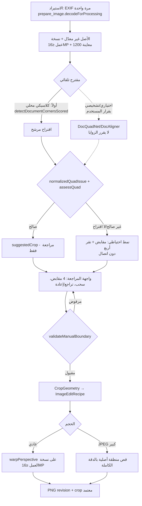

# تقرير هندسي: آلية القص في تطبيق «مكتبتي برو» وخطة تكامل مع Scan-id

**المرحلة:** 1 (دراسة + خطة فقط). لم يُعدَّل أي كود تطبيق، ولم يُفتح PR، ولم تُنفَّذ أي اختبارات (قُرئت فقط).
**المرجع:** `مكتبتي برو.zip` و`مكتبتي برو.apk` (في جذر المستودع). المطابقة: ZIP = محتويات APK، 138 ملفاً متطابقاً بايتاً ببايت.
**مستودع الدراسة:** `arena/9c08ad5c-scan-id` عند `cc4ab7a` (= `origin/searchidf`).
**التاريخ:** 2026-11-01.

---

## 0. الخلاصة التنفيذية

1. **الكشف التلقائي في APK كلاسيكي بالكامل** (OpenCV: Canny + Otsu + contours + approxPolyDP). لا توجد أي مكتبة ML (لا TFLite/ONNX/MLKit في DEX). الاستثناء الوحيد: `FaceDetector` يُستخدم لتحديد **اتجاه** البطاقة (لا الزوايا).
2. **الزوايا في APK تُقترح تلقائياً ثم يؤكدها المستخدم**، ولا يقص التطبيق وحده (وفق CHANGELOG 1.0.0: "never crops on its own"، ومؤكَّد في بنية الكود: لا يوجد مسار قص تلقائي بلا تفاعل).
3. **Scan-id حالياً:** سلسلة الاقتراح تبدأ بنموذجين ذكيين (DocQuadNet ثم DocAligner، ويُشغَّلان دائماً معاً)، والكاشف الكلاسيكي احتياطي فقط. **الاقتران مُثبت على مستوى الاقتراح**: الزوايا المعروضة للمراجعة تأتي من AI في الحالة الطبيعية.
4. **لا يوجد اقتران مُثبت على مستوى التفويض**: نماذج AI تُمرَّر بـ`minAutoAcceptConfidence: 1.01` فيُضاف دائماً سبب المراجعة `lowModelConfidence`، والكاشف الكلاسيكي يُضاف إليه `uncalibratedClassicalScore`. لذلك **لا يستطيع أي مقترح أن يصبح `accepted` في البنية الحالية**، ولا يُنشأ `AutomaticCropAuthorization` من أي مصدر إنتاجي.
5. **الفرق الجوهري في الحجم والدقة:** APK يقص من نسخة تخزين بسقف 4096 بكسل على الضلع الأطول، ويكشف على 800 بكسل. Scan-id يحتفظ بالصورة الأصلية ويقص بدقة كاملة حتى 16 ميغابكسل، ويقرأ JPEG الكبير حتى 32 ميغابكسل عبر منطقة أصلية أصغر.
6. **فروق تصميمية يجب عدم استيرادها:** APK يفرض نسبة وثيقة المستمسك على ارتفاع المخرج (`outH = width / ratio`)، بينما Scan-id يحافظ على النسبة المقاسة ولا يمط الصورة. يجب الإبقاء على سياسة Scan-id.
7. **القرار المطلوب (Stage gate):** تأكيد ثلاثة قرارات قبل أي تنفيذ (القسم 19.3): (أ) هل يبقى الاقتراح مراجعةً فقط؟ (ب) هل يُفصل AI عن اختيار الزوايا؟ (ج) شكل نمط النقر الأربع الاحتياطي.

---

## 1. النطاق والمنهج وقواعد التصنيف

**التصنيفات المستخدمة في كل حقيقة:**

| الرمز | المعنى | شرط الاستخدام |
|---|---|---|
| **مُثبت** | مُتحقَّق منه مباشرة | قراءة مصدر Scan-id، أو بايتكود/مفكِّك APK مع استدعاءات مؤكدة، أو ثوابت مقروءة |
| **مستنتج** | استنتاج معقول من أدلة جزئية | يُذكر دليل الاستنتاج صراحةً |
| **غير قابل للإثبات من APK** | لا يمكن إثباته من الملفات المتاحة | (مثل: إصدار OpenCV الأصلي، سلوك `.so` غائب) |

**أدوات APK:** Androguard 4.1.4 (Python) فقط؛ لا Java/JADX/apktool. تم تفكيك الأصناف بـ`DvMachine`، وتم التحقق من منطق حرج بالبايتكود (`code.show()`).

**أرقام الأسطر:** تقريبية (±2 أسطر) ما لم تُذكر بدقة، لأنها مأخوذة من عرض `grep` وقراءة جزئية.

**قيود معروفة:** المفكِّك يُسقط أحياناً `goto/continue` ويخلط الأنواع؛ لذلك أي منطق حرج حُقِّق منه بالبايتكود وأُشير إليه. ما لم يُحقَّق منه بالبايتكود يُعلَّم صراحة.

**لم يُنفَّذ:** `flutter test` ولا أي اختبار. كل الاختبارات في القسم 20 مُقترَحة ومقروءة من الملفات فقط.

---

## 2. هوية المرجع (ZIP/APK)

| البند | القيمة | التصنيف |
|---|---|---|
| تطابق ZIP مع APK | 138 ملف، متطابق بايتاً ببايت | مُثبت |
| `classes.dex` | DEX v38، 4,883 صنف، 27,368 دالة، 21,637 نصاً | مُثبت |
| مكتبات أصلية `lib/*.so` | غائبة | مُثبت |
| OpenCV في DEX | مراجع `org/opencv/*` (1,543 دالة تستدعيها) | مُثبت |
| OpenCV في CHANGELOG 1.1.8 | "slim build (core, imgproc, photo)، ~8MB native" بينما لا `.so` في APK | مُثبت (تناقض مُبلَّغ) |
| إصدار OpenCV الفعلي | غير معروف | غير قابل للإثبات من APK |
| `MaktabatiProApp.onCreate()` يستدعي `OpenCVLoader.initLocal` | نعم | مُثبت |
| ML (TFLite/ONNX/MLKit) في DEX | لا توجد أصناف | مُثبت (بحث في `classes.txt` = 0) |
| `FaceDetector` | مُستخدم في `Lwv3.i(Bitmap,F)I` ← `Lhz2.r(DocumentType, List)I` (اتجاه البطاقة) | مُثبت |

---

## 3. خريطة الأصناف المموّهة (APK)

| الاسم المموّه | الدور | التحقق |
|---|---|---|
| `Lvf2` | `PointD` (x,y) | مُثبت |
| `Lkm2` | `Quad(TL,TR,BR,BL)` | مُثبت (المُنشئ) |
| `Llm2` | مساعد Quad: المساحة، المركز، النسبة، الصلاحية | مُثبت |
| `Lsz2.r(List)` | ترتيب 4 نقاط إلى Quad | مُثبت بالبايتكود (القسم 4.2) |
| `Lsz2.y(approx, contour)` | تنقيح الزوايا بخطوط الأضلاع | جزئي (القسم 8.4) |
| `Lwp1` | الاختيار والمنظور: `s` (اختيار المرشحين)، `g` (تصفية)، `G` (إزالة الحاويات)، `f` (تحويل المنظور) | مُثبت (f مُفكَّك؛ s وG مُحقَّقان بالبايتكود) |
| `Lec0` | الكاشف: `c` (المسار)، `d` (تصفية الكنتورات)، `a` (Canny+إغلاق+تمدد)، `b` (فحص 3 زوايا) | مُثبت |
| `Lno` | مصادر الأقنعة: حالة 11/12 Canny، 13 contourArea، 14 approxPolyDP | مُثبت |
| `Lt` | `shapeMask` (حالة 1) | مُثبت (بايتكود) |
| `Lj23` | مساعد قناع المرشح (عتبات + أكبر مكوّن) | جزئي |
| `Lel0` | `DocumentType` (تسمية ونسبة) | مُثبت |
| `Lne0` | `CropViewModel`: `e` إضافة نقطة، `g` قص، `h` تشغيل القص، `i` تحميل الصورة | مُثبت |
| `Lme0` | coroutine الكشف التلقائي وتعبئة الزوايا | مُثبت (استدعاءات) |
| `Lgd0` | معالج النقر (إضافة نقطة) | مُثبت |
| `Lid0` | معالج الضغط/السحب | مُثبت |
| `Ln81` | `ImageViewport`: التحويل شاشة↔صورة والتثبيت | مُثبت |
| `Lhz2` | محرّك القص والحفظ الجماعي: `e` (قص صورة واحدة)، `f` (دفعة)، `r` (اتجاه)، `s` (حفظ JPEG) | مُثبت |
| `Lb3` | ملف الصور: `i(File,maxSide)` (فك بتصغير)، `j(ContentResolver,Uri,…)` (استيراد + EXIF)، `m` (حفظ JPEG) | مُثبت |
| `Lcz2` | محمِّل الصورة للشاشة: 1600 بكسل للمعاينة، 2048 بكسل للتحميل | مُثبت |
| `Lik3` | الدرس التعليمي (ليس مسار القص الإنتاجي) | مُثبت |

---

## 4. التحديد اليدوي للزوايا الأربع: التسلسل والترتيب والتحويل

### 4.1 ما يفعله التطبيق (مُثبت)

- **الإضافة بالنقر:** `Lgd0.j` (معالج النقر) يعمل فقط عندما يكون علمه `U` مفعّلاً. إذا كان عدد النقاط < 4 ولم يقع النقر ضمن نصف قطر مقبض موجود، يحوّل الإحداثية من الشاشة إلى الصورة عبر `Ln81.i`، ثم يرفض النقاط خارج `[0,W]×[0,H]`، ثم يستدعي `Lne0.e(النقطة المقيّدة)`.
- **`Lne0.e(PointD)`:** يضيف النقطة فقط إذا كان الحجم < 4 والعلم `f` = false (قفل تزامني عبر حالة `StateFlow`). **الترتيب في القائمة = ترتيب النقر** (1..4).
- **التحويل شاشة → صورة (`Ln81`، مُثبت):**
  - `fit = min(cw/iw, ch/ih)`، `f = fit × zoom`
  - إزاحة `d = (cw − f·iw)/2 + pan_x`، `e = (ch − f·ih)/2 + pan_y`
  - `i(sx, sy) = ((sx − d)/f, (sy − e)/f)`
  - `a(PointD)` يقيّد إلى `[0, W−1] × [0, H−1]`
- **عدم إضافة نقطة داخل مقبض موجود:** النقر داخل نصف قطر مقبض لا يضيف زاوية جديدة (`nd0.g(list,x,y,radius) < 0` شرط الإضافة).

### 4.2 تسلسل النقر الأربع — تحقق من البايتكود والكود

- **مُثبت:** `Lne0.e` تُلحق بترتيب الوصول. الحد 4 مُطبّق في `Lne0.e` لا في الواجهة فقط.
- **مُثبت:** `Lwp1.f` يستدعي `Lsz2.r(points)` قبل أي حساب، أي أن **تسمية الزوايا النهائية (TL/TR/BR/BL) تُعاد حسابها هندسياً عند القص، ولا تعتمد على ترتيب النقر.**
- **مُثبت:** أرقام "Corners n / 4" في CHANGELOG 1.0.0 تمثل ترتيب النقر للعرض فقط.

**ترتيب `Lsz2.r` (مُحقَّق بالبايتكود/المفكِّك، القيم القصوى):**

| الزاوية | المعيار | الاختيار |
|---|---|---|
| TL | argmin(x+y) | الأصغر مجموع |
| TR | argmax(x−y) | الأكبر فرق |
| BR | argmax(x+y) | الأكبر مجموع |
| BL | argmin(x−y) | الأصغر فرق |

- **مُثبت:** `Lsz2.r` يرفض أي عدد ليس 4 (يسجل ويعيد null).
- **مستنتج (مخاطرة):** اختيار القيم القصوى لا يضمن أن الأركان الأربع نقاط مختلفة؛ إذا كانت نقطة واحدة قصوى في معيارين قد تتكرر الزاوية. لم يُختبر ذلك. يجب إضافة اختبار لهذه الحالة قبل الاعتماد عليه.

### 4.3 مقابلة Scan-id (مُثبت)

- Scan-id **لا يملك تسلسل نقر**. الزوايا الأربع دائماً موجودة كمقابض (`crop-corner-0..3`، `crop_screen.dart` ≈1290–1360)، وتبدأ إما من الاقتراح أو من الإطار الكامل (`CropDraft.fullImage()`، `crop_screen.dart:382`).
- **الترتيب ثابت بالفهرس:** `CropDraft.corners` تعني TL, TR, BR, BL (`geometry.dart:142`). `PerspectiveMap` يربط `u=0,v=0` بـ`corners[0]` مباشرةً (`perspective.dart:13-22`).
- **مستنتج (خطر):** `normalizedQuadIssue` (`geometry.dart:231`) يتحقق من التحدّب واتجاه اللفّ والمساحة، ولكنه **لا يتحقق من أن الفهرس 0 هو الزاوية العلوية اليسرى**. إزاحة دورية للفهرس تُنتج مخرجاً مُدَوَّراً أو مقلوباً بدل الرفض. يحتاج اختباراً (الحالة T01 في القسم 20).

---

## 5. تعديل الزوايا (السحب)

### 5.1 نصف أقطار الالتقاط (مُثبت بالبايتكود)

| الوظيفة | المعامل | الحساب | التصنيف |
|---|---|---|---|
| إضافة بنقرة (`Lgd0`) | نصف القطر `T` | `28 × Lhb3.b()` | مُثبت |
| سحب مقبض (`Lid0` حالة 0) | نصف القطر `U` | `32 × Lhb3.b()` | مُثبت |
| معامل ثالث في `Lhd0` | `b() × 40` (غرض غير محدد) | — | غير محدد |

- `Lhb3.b()` ← `Lui0.b()`: مصدر كثافة (density). **مستنتج** أنه كثافة شاشة (dp→px)، ولم يُثبت من الاسم.

### 5.2 منطق السحب

- `Lid0` حالة 0 (ضغط): يضبط العلم `Y` ثم يستدعي `nd0.g(list,x,y,R)` ليجد أقرب مقبض ضمن نصف القطر، ويعيد الفهرس عبر `ac2.h(index)`.
- `Lid0` حالة 1 (بدء السحب): ينشئ مهمة `jg` بقائمة الأربع ويستدعي `tn1.i`، وهي مكتبة إيماءات Compose عامة.
- `xa3(list,1)`: **ليس** كتابة إحداثيات؛ هو مجرد إعادة ضبط `lg.Y = 0` عند الانتهاء (مُثبت بالبايتكود).
- **غير قابل للإثبات من APK بعد:** الموقع الذي يُكتب فيه الإحداثي الجديد للزاوية أثناء السحب. تتبّعت الكتابات في `Lmx`، ولم أجد `List.set` إلا لكائن RectF للرسم. الكتابة المرجَّحة تتم عبر إنشاء قائمة جديدة في مسار الحالة، لكن لم أحدّد الدالة.

### 5.3 التقييد (مُثبت)

- `Ln81.a(PointD)` يقيّد إلى `[0, W−1] × [0, H−1]`.
- `Lgd0` (عند الإضافة) يرفض خارج `[0,W] × [0,H]`. **تناقض طفيف** (W مقابل W−1). الفرق بكسل واحد. **مستنتج** أنه غير مؤثر عملياً.

### 5.4 مقابلة Scan-id (مُثبت)

- السحب عبر `GestureDetector.onPanUpdate` لكل مقبض: `local/width` مع `clamp(0,1)` (`crop_screen.dart` ≈1316–1348).
- التحويل يتم بـ`RenderBox.globalToLocal` على الكانفاس، وهو يأخذ في الحسبان تحويل `InteractiveViewer` (التكبير 1..5، `crop_screen.dart` ≈1264). **مستنتج:** هذا يعمل بشكل صحيح مع التكبير لأن Flutter يحسب المصفوفة.
- التحديث عبر `CropDraft.withCorner(i, point)` (`crop_draft.dart:49`)، والمسودة قد تتقاطع أثناء السحب، والتحقق يتم عند `toRecipe` فقط (تعليق `crop_draft.dart:14`).
- التراجع/الإعادة: `_undo` و`_history` (`crop_screen.dart:698`).

---

## 6. فحوص صلاحية الرباعي (Quad validity)

### 6.1 في APK (مُثبت، مع حدود)

**`Llm2.c(ratio)` (صلاحية النسبة):**
- ترفض إذا `|e/ratio − 1| > 0.15` (حيث `e` = النسبة المقاسة).
- ترفض إذا انحرفت أي زاوية داخلية عن 90° بأكثر من 40°.
- تقبل إذا `|alt/ratio − 1| < 0.02` **أو** `|e/ratio − 1| ≤ |e/alt − 1|`، حيث `alt = 1.585` عندما يكون `ratio = 1.414` (A4)، وإلا `alt = 1.414`.

**`Llm2.a(PointD)` (احتواء نقطة):** اتساق إشارات الضرب الاتجاهي على الأضلاع الأربعة.

**مكان الاستدعاء (مُثبت):**
- `Llm2.c` يُستدعى من `Lme0.r` (الكشف التلقائي) و`Lwp1.g` و`Lwp1.s` فقط.
- **لا يُستدعى** من مسار القص اليدوي (`Lne0.g/h`).
- `Llm2.a` يُستدعى من `Lee0.r`, `Lme0.r`, `Lwp1.G`, `Lwp1.s`.

**النتيجة (مستنتج قوي):** القص اليدوي في APK **لا يتحقق من التحدّب أو الزوايا**. الرباعي المتقاطع يصل إلى `warpPerspective` ويُنتج مخرجاً مشوّهاً بدل الرفض. يُرفض فقط إذا فشل `Lwp1.f` (أقل من 4 نقاط، مساحة صفرية، أو مخرج فارغ) فيُعاد نسخة من الإدخال.

### 6.2 في Scan-id (مُثبت)

| الفحص | الموقع | الحد |
|---|---|---|
| عدد النقاط، القيم المحدودة، النطاق [0,1] | `normalizedQuadIssue` (`geometry.dart:231`) | — |
| التحدّب واتجاه اللفّ | نفس الدالة | `cross > 1e-6` |
| المساحة الموقّعة | نفس الدالة | `twiceArea > 1e-4` |
| الإحداثيات المتجانسة قابلة للعكس | `PerspectiveCoefficients.tryFrom` (`geometry.dart:172`) | المحددات `> 1e-9` |
| التحقق اليدوي بالبكسل | `validateManualBoundary` (`manual_boundary.dart:98`) | حدود بكسلية (تسامح 1e-9)، تقاطع الأقطار، `crossNorm > 1e-6` و`crossPx > 1e-3`، ضلع ≥ 4 بكسل، مساحة ≥ 0.2% **و** ≥ 16 بكسل |
| التحقق من الهوموغرافيا | `_hasStableHomography` (`manual_boundary.dart:1138`) = `normalizedQuadIssue == null` | — |
| فحص الاستعمال قبل القص | `_recipe()` في `crop_screen.dart:713` يستدعي `requireValidManualBoundary` | يرمي استثناء |
| تقييم الكشف | `assessQuad` (`quad_assessment.dart`) | مساحة ≥ 2%، ضلع ≥ 4 بكسل، نسبة الأضلاع المتقابلة ≤ 2.5، نسبة الطول/العرض ≤ 12 |

**الفرق المهم:** عتبة المساحة للكشف (2%، `assessQuad`) أكبر بعشر مرات من عتبة اليدوي (0.2%، `validateManualBoundary`). هذا مقصود (الاقتراح أصعب من التحديد اليدوي للبطاقات الصغيرة داخل الإطارات الواسعة)، لكنه يجب أن يُوثَّق في الخطة.

**وضع Scan-id أفضل من APK** لأن الرباعي المتقاطع لا يصل إلى القص أبداً (مُثبت بالتسلسل: `_recipe()` ← `requireValidManualBoundary`).

---

## 7. الكشف التلقائي عن حواف المستمسك (APK)

### 7.1 مسار الاستدعاء (مُثبت)

```
Lcz2.r / Liv0.r  →  Lb3.i(File, 1600 | 2048)   [فك بتصغير؛ يعيد ai2(bitmap, origW, origH)]
Lme0.r (coroutine الكشف التلقائي)  →  Ljj case 10  →  Lec0.c(Mat, Lel0)
Ljj case 10:  Utils.bitmapToMat(bitmap) (دقة كاملة للبitmap المُحمَّل)  →  النقاط × (origW / bitmap.width)
```

### 7.2 تفاصيل `Lb3.i(File, maxSide)` (مُثبت)

- الحلقة: يبدأ `inSampleSize = 1`، ويضاعف طالما `max(W,H) / (2·s) ≥ maxSide`. النتيجة: أكبر قوة 2 تُبقي الضلع الأطول ≥ `maxSide`.
- يُرجع `ai2(bitmap, W_original, H_original)`.

### 7.3 `Lec0.c(Mat, Lel0)` — خط الأنابيب (مُثبت، مرتَّب)

1. **تصغير:** `scale = 800.0 / max(cols, rows)` ثم `Imgproc.resize`. لا حد أدنى؛ الصور الصغيرة تُكبَّر (**مُثبت** من الثابت، **مستنتج** للتكبير من غياب الحد).
2. **أربعة مصادر أقنعة/حواف:**
   - `Lno(11)` → `ec0.a(mat, 50, 150, 3)`
   - `Lno(12)` → `ec0.a(mat, 20, 60, 7)`
   - `t(1, ec0, "shapeMask")` → قناع الشكل (القسم 7.4)
   - `Lj23.d(scaledMat)` → قناع المرشحات (جزئي، القسم 7.5)
3. **`ec0.a` (Canny chain، مُثبت):** فصل القنوات → `GaussianBlur 5×5` → `Canny(lo, hi, الوسيط الثالث)` (3 أو 7، متسق مع فتحة Canny) → OR بين القنوات → `MORPH_CLOSE` بنواة مستطيلة → `dilate` بنواة 3×3.
4. **`ec0.d(mask, A)` (تصفية الكنتورات، مُثبت):**
   - `findContours(RETR_LIST=1, CHAIN_APPROX_NONE=1)`
   - فلتر المساحة `dc0(A)`: `0.015·A ≤ area ≤ 0.98·A` (مُثبت بالبايتكود: الثوابت `0.015` و`0.98`)
   - ترتيب تنازلي حسب المساحة (المقارن `hy0(7)` مع عكس الوسائط في `xi.s`)
   - `si0(…, comparator, 3)` → **أعلى 3 كنتورات** (مُثبت الاستدعاء؛ فرع `si0` الحالة 3 لم يُفكَّك بعد، فالتفسير "أعلى 3" مستنتج من الوسيط والمقارن)
   - `zu0(…, b=0, kt2(21))` يُسقط القيم الفارغة (مستنتج)
5. **تقريب المضلع (`Lno` حالة 14، مُثبت):** `approxPolyDP(closed=true, ε = k·arcLength)`، `k ∈ {0.02, 0.03, 0.04, 0.05}` (مُثبت الثوابت، لكن **الصفيف المنسوب إلى `ec0.b` غير مؤكد**، لأن `ec0.b(Mat)` يُستخدم أيضاً كفحص منطقي لثلاث زوايا). أول تقريب بأربع نقاط محدّبة يُقبل.
6. **تنقيح الزوايا:** `Lsz2.y(approxPts, contourPts)` (القسم 8.4).
7. **الاختيار:** `Lwp1.s(candidates, DocumentType.ratio, imageArea)` (القسم 8).
8. **العودة:** القسمة على `scale` لإرجاع الإحداثيات إلى حجم `bitmap` ثم الضرب في `origW / bitmap.width` (عبر `Ljj`).

**الدقة (مستنتج):** الكشف يتم على 800 بكسل كحد أقصى للضلع الأطول، والتحويل إلى الصورة الأصلية يتم بالنسب. دقة الزاوية ≈ بكسل واحد من الـ800 بكسل مضروباً في عامل التكبير، أي نحو `origW/800` بكسل في الصورة الأصلية، إلا إذا عوّض التنقيح الفرعي (`Lsz2.y`) ذلك. لم يُقَس.

### 7.4 `shapeMask` (مُثبت بالبايتكود، `Lt` حالة 1)

1. `cvtColor`: `RGBA2GRAY` (رمز 11) إذا كانت 4 قنوات، وإلا `RGB2GRAY` (رمز 7).
2. `GaussianBlur 9×9`.
3. `threshold(THRESH_OTSU = 8, max = 255)`.
4. إذا كانت ≥ 3 زوايا من القناع "بيضاء" (`ec0.b(bin)`، **مستنتج**): `bitwise_not`.
5. `getStructuringElement(MORPH_RECT = 0, 7×7)`، ثم `morphologyEx OPEN (2)` ثم `CLOSE (3)`.

### 7.5 `Lj23.a` (جزئي)

- أزواج (عتبة، نواة 9): القائمة A = {12, 15, 20}، القائمة B = {8, 12, 16}.
- بكسلات ≥ العتبة؛ إذا كان أكبر مكوّن متصل < 20% من مساحة الصورة لا يُنتج قناعاً.
- تشغيل: فتح 3×3 ثم تآكل 3×3.
- **غير مُكتمل:** لم أقرأ `Lj23.d/e` كاملاً.

### 7.6 تحديد نوع المستمسك (مُثبت)

`Lel0` (DocumentType): تسمية `T` ونسبة `U`:
- ID_CARD: 1.585
- RESIDENCE_CARD: 1.4754
- PASSPORT: 1.4205
- A4_DOCUMENT: 1.414

CHANGELOG 1.1.6 يذكر مقاسات (ID 8.56×5.4 سم، residence 9×6.1 سم، passport 8.8×12.5 سم) **لم أتحقق منها في الكود**، فهي موثقة فقط.

### 7.7 اتجاه البطاقة (APK، مُثبت)

- `Lhz2.r(DocumentType, List) → int` يستدعي `Lwv3.i(Bitmap, F)` الذي يستخدم `FaceDetector.findFaces` ويعيد اتجاهاً.
- `Lhz2.s(…, rotation)` يدوّر المخرج بـ`postRotate(rotation × 90°)` **إذا كان الارتفاع > العرض** (`Lhz2.s` قبل الحفظ).
- هذا **ليس** قراراً للزوايا، فلا يستدعي `Lwp1` أو `Lec0`. الفصل مُثبت من الرسم البياني للاستدعاءات.

---

## 8. اختيار المرشحين والإزالة والترتيب (APK)

### 8.1 `Lwp1.s(candidates, ratio, imageArea)` (مُثبت، بخطوات)

1. **تصفية الأحجام:** الاحتفاظ بالقوائم ذات 4 نقاط فقط، ثم `Lsz2.r` لتحويلها إلى Quad، مع مساحة > 0.
2. **الترتيب:** حسب المساحة تنازلياً (`hy0(11)`).
3. **إزالة التكرار** (مُثبت بالبايتكود): يُتجاوز المرشح إذا وُجد مرشح مقبول سابقاً يحقق **كلاً من**:
   - المسافة بين المركزين `< 0.1 × √min(areas)`
   - نسبة المساحتين `min/max > 0.75`
4. **الصلاحية:** `area ≥ 0.015 × imageArea` **و** `Llm2.c(ratio)`.
5. **إزالة الحاويات `Lwp1.G`** (مُثبت بالبايتكود): يُحذف الرباعي إذا كان مركزه داخل مرشح آخر مساحته `< 0.5 ×` مساحته.
6. **الترتيب بالصفوف:**
   - تُجمَّع في صفوف إذا كان فرق `y` بين المركزين `< 0.5 × min(d)` (حيث `d` = متوسط الضلع الأيسر والأيمن)
   - الصفوف مرتبة بـ`hy0(12)` (y للمركز تصاعدياً)، ثم داخل الصف `hy0(13)` (x تصاعدياً)
   - تُسطّح بترتيب القراءة.
7. **المرشحون الاحتياطيون:** تُلحق الرباعيات غير الصالحة ذات `area ≥ 0.1 × imageArea` **بعد** الصالحة.

### 8.2 `Lwp1.g(list, ratio)` (مُثبت)

- يُعيد المرشحين الصالحين فقط (4 نقاط، مساحة > 0، `c(ratio)`) بعد إزالة الحاويات `G`، بترتيب الإدخال.
- يُستدعى من `Lme0.r`، و`Lee0.r`، و`Lxa1.h`.

### 8.3 الاحتياطي من الكشف إلى اليدوي (APK)

- **مُثبت:** لا يوجد كشف ← لا تعبئة زوايا؛ يبقى الإطار الفارغ/الحالي، والمستخدم ينقر بنفسه.
- **مُثبت:** `Lwp1.s` يُلحق **مرشحين احتياطيين غير صالحين** بعد الصالحين. كيف تتعامل الواجهة معهم (تعبئة مباشرة أم تجاهل) **غير قابل للإثبات بعد** لأني لم أتتبع `Lme0.r` حتى الواجهة.
- CHANGELOG 1.0.2/1.0.5: "auto-detect pre-fills corners" (موثق، لم يتحقق منه في الكود).

### 8.4 تنقيح الزوايا `Lsz2.y` (جزئي — مُنصَف)

- **مُثبت:** يستدعي تحقق `Lsz2.y` `size == 4` ويرفض غير ذلك.
- **مُثبت:** ثوابت: `1e-6` (حد التوازي)، `0.03` و`2.0` في تسامح الانحراف (`max(2.0, 0.03 × v)`، مُفكَّك)، `0.15` و`0.85` (نطاق اتجاه الخط)، `0.5`.
- **المنهج المستنتج:** لكل ضلع من المضلع التقريبي تُجمع نقاط الكنتور القريبة من الضلع، تُركَّب خط (نقطة + اتجاه بـ`cos/sin` من `atan2`)، ثم تُحسب الزوايا كتقاطع الخطوط المتجاورة. عند التوازي (`|det| < 1e-6`) أو عند بُعد التقاطع (أكثر من `0.15` من طول الضلع المجاور، `sz2.f(...) × 0.15`) يُرجع الزاوية الأصلية.
- **غير مُكتمل:** لم أُثبت الصيغة الدقيقة لتركيب الخط، ولا عدد نقاط الكنتور المستخدمة.

---

## 9. مخرجات الكشف وتعبئة الواجهة (APK)

- `Lme0` يُعبئ القائمة عبر `Lne0.e` (مُثبت: `Lme0.r` يستدعي `Lne0.e`).
- الواجهة تعرض الزوايا المُعبأة كمقابض، ويستطيع المستخدم سحبها أو إعادة التعيين (CHANGELOG 1.0.0: "Undo").
- "Crop all N" (CHANGELOG 1.0.6): قص جماعي بضغطة واحدة للبطاقات المكتشفة، **مُنفَّذ بطلب من المستخدم** (`Lhz2.f`)، وليس تلقائياً.

---

## 10. الانتقال من الكشف التلقائي إلى اليدوي (مقارنة)

| الحالة | APK | Scan-id |
|---|---|---|
| لا يوجد اقتراح | الإطار يبقى كما هو، والمستخدم ينقر (مُثبت بالفرع) | الإطار الكامل كمقابض (مُثبت، `crop_screen.dart:382`) + رسالة للمستخدم (`_suggest`) |
| اقتراح غير صالح | تعبئة بالمرشحين الاحتياطيين (مستنتج) | يُرفض ويُعرض سبب المراجعة (مُثبت: `verifyBoundary` → `needsReview`) |
| فشل الكشف (استثناء) | لم أتتبعه بعد (غير مُكتمل) | `_attempt` يلتقط الاستثناء ويستمر (مُثبت، `boundary_proposal_cascade.dart`) |
| إلغاء | `CancellationException` (مُثبت، `Lb01`/`coroutine`) | `OperationCancelled` + `CancellationToken` (مُثبت) |
| الحفاظ على الأصل | غير مُثبت (انظر القسم 16) | مُثبت (`ImageAsset` + `processingInputPath`، `local_image_editor.dart`) |

**الفرض على "لا يُقص الصورة بدون المستخدم":**
- APK: **مستنتج** من CHANGELOG وعدم وجود مسار قص آلي بلا `Lne0.g` (زر).
- Scan-id: **مُثبت** بالتصميم (`AutomaticCropAuthorization` لا يُنشأ إلا من `accepted`، ولا يُقبل مقترح إنتاجي كـ`accepted`، القسم 12).

---

## 11. التحويل المنظوري والإخراج (APK)

### 11.1 `Lwp1.f(Mat, List<PointD>, Lel0)` (مُفكَّك بخطوات بسيطة، تحقق جزئي)

```
Quad q = Lsz2.r(points)                          // ترتيب هندسي (القسم 4.2)
width  = max(|q.BR - q.BL|, |q.TR - q.TL|)       // أعلى/أسفل
height = max(|q.TR - q.BR|, |q.TL - q.BL|)       // يمين/يسار
if (height <= width) outH = width / ratio        // أفقي: يُفرض نسبة الوثيقة
else                  outH = width * ratio       // عمودي
if (width > 0 && outH > 0):
    src = [TL, TR, BR, BL]
    dst = [(0,0), (W−1,0), (W−1,H−1), (0,H−1)]
    M   = getPerspectiveTransform(src, dst)
    out = warpPerspective(input, M, Size(width, outH))   // الافتراضيات: INTER_LINEAR, BORDER_CONSTANT
    if (!out.empty()) return out
return input.clone()                              // تراجع: نسخة من الإدخال
```

- **مُثبت:** التحويلات والثوابت (`1.0`) والتسلسل.
- **مُثبت:** `warpPerspective` بالتوقيع ذي الأربعة معاملات يستخدم الافتراضيات. **مستنتج** أنها `INTER_LINEAR` و`BORDER_CONSTANT` وفق توثيق OpenCV، لا من البايتات (لا توجد `.so` في APK).
- **غير قابل للإثبات من APK:** إصدار OpenCV، وسلوك حدود الصورة الفعلي، وأي `Size` مقيّد.

### 11.2 الإخراج والترميز (مُثبت)

- `Lhz2.e` (قص صورة): `BitmapFactory.decodeFile(file, ARGB_8888)` ← **دقة كاملة للملف المخزَّن** (لا `inSampleSize`) ← `Utils.bitmapToMat` ← `Lwp1.f` ← `Bitmap.createBitmap(cols, rows, ARGB_8888)` ← `Utils.matToBitmap`. ثم تحرير كل Mat ومعالجة Bitmap المصدر بـ`recycle()`.
- `Lhz2.s` (حفظ): `Bitmap` مدوّر حسب الحاجة ← `b3.m(JPEG, quality 95)` ← ملف `cropped_<id>.jpg`، ويُحذف الملف السابق إن وُجد.
- **مُثبت:** `b3.m` يكتب إلى `<name>.tmp` ثم يحذف الهدف إن وُجد ويعيد التسمية (الجزء الأخير من التسلسل مُفكَّك جزئياً).

### 11.3 ماذا يحدث للأبعاد الكبيرة (مُثبت)

- `Lb3.j(ContentResolver, Uri, File)` (الاستيراد):
  1. قراءة الحدود (`inJustDecodeBounds`).
  2. `inSampleSize` بحيث يبقى الضلع الأطول ≥ 4096 (**مُثبت**).
  3. `decodeStream` بذلك التصغير.
  4. قراءة اتجاه EXIF عبر `ls0` (ExifInterface مموّهة) بالوسم `"Orientation"` مع افتراض `1`.
  5. مصفوفة `Matrix` حسب الاتجاه: 2 قلب أفقي؛ 3 تدوير 180°؛ 4 قلب عمودي؛ 5 تدوير 90° + قلب؛ 6 تدوير 90°؛ 7 تدوير 270° + قلب؛ 8 تدوير 270°.
  6. إذا كان `max(W,H) > 4096` يُضاف `postScale(4096 / max)` (**مُثبت**).
  7. `createBitmap` بالمصفوفة إن لم تكن هوية، ثم `b3.m` (JPEG 95).
- **النتيجة:** صورة التخزين الأساسية **≤ 4096 بكسل على الضلع الأطول، مُدارة EXIF مرة واحدة، وبصيغة JPEG 95**. هذا هو مصدر القص.

**مستنتج:** أن الملف المخزَّن هو الذي يقرأه `Lhz2.e` (اسم الحقل `oy2.c`)، لكن لم أتحقق من دلالة الحقل بالضبط.

---

## 12. Scan-id: الهندسة الحالية (مُثبت)

### 12.1 النماذج الأساسية

| الصنف/الدالة | الملف:السطر | الدور |
|---|---|---|
| `Point2` | `lib/domain/geometry.dart:75` | إحداثيات normalized، `require` للقيم المحدودة |
| `RectMm` | `geometry.dart:88` | مستطيل مليمتري (للتصميم والتصدير) |
| `PerspectiveCoefficients.tryFrom` | `geometry.dart:172` | معاملات التحويل المتجانس `a..h`، ويرفض المحددات ≈ 0 |
| `normalizedQuadIssue` | `geometry.dart:231` | فحص الرباعي المُطبَّع (القسم 6.2) |
| `CropGeometry` | `geometry.dart:257` | `corners` + `outputWidth/outputHeight` + فحص الميزانية `withinImageBudget` |
| `CropDraft` | `lib/domain/crop_draft.dart:16` | مسودة السحب، `withCorner`، `toRecipe` |
| `ImageEditRecipe` | `crop_draft.dart:8` | `(CropGeometry, ImageAdjustments)` |
| `validateManualBoundary` | `lib/domain/manual_boundary.dart:98` | التحقق اليدوي الكامل |
| `requireValidManualBoundary` | `manual_boundary.dart:281` | نسخة ترمي استثناء |
| `assessQuad` | `lib/domain/quad_assessment.dart` | تقييم الكشف والهندسة والثقة |
| `BoundaryProposal`, `BoundaryDecision`, `verifyBoundary`, `AutomaticCropAuthorization` | `lib/domain/boundary_decision.dart` (≈ 208، 264، 290+) | الاقتراح → التحقق → القرار |
| `PerspectiveMap`, `warpPerspective`, `renderPerspective` | `lib/imaging/perspective.dart:13,35,27` | التحويل المنظوري |
| `decodeForProcessing`, `prepareImage` | `lib/imaging/prepare_image.dart:28` | فك الترميز + EXIF مرة واحدة |
| `detectDocumentCornersScored` | `lib/imaging/document_detector.dart:61` | الكاشف الكلاسيكي |
| `BoundaryProposalCascade` | `lib/imaging/boundary_proposal_cascade.dart` | DocQuadNet ثم DocAligner ثم احتياطي |
| `LocalImageEditor.suggestProposal` | `lib/persistence/local_image_editor.dart:98` | ربط الكشف بالمحرر |
| `DocQuadNet256`, `DocAlignerFastViT` | `lib/imaging/docquad_model.dart:121-127`، `docaligner_model.dart:136-139` | نماذج ONNX |
| `CropScreen` | `lib/presentation/crop_screen.dart` | واجهة القص (القسم 5.4) |
| `FullResolution…` | `lib/imaging/full_resolution_manual_crop.dart` + `lib/application/full_resolution_jpeg_cropper.dart` | القص بدقة كاملة للـJPEG الكبير |
| حدود الصور | `lib/domain/image_limits.dart:2-19` | 20 MB، 16 MP، 32 MP للمصدر JPEG، 4 MP للعامل المصغّر، 1200 للمعاينة |
| `Project.schemaVersion` | `lib/domain/project.dart:846` | `= 5` |
| `DetectionRef` | `lib/domain/recognition.dart` ≈ 280–350 | `polygon` (مقبول) منفصل عن `suggestedPolygon` (للمراجعة) |
| `referenceSchema` | `lib/reference_annotation/store.dart:16` | `scan-id-local-annotations-v2` |

### 12.2 الحدود والميزانية (مُثبت)

- `maxImportPixels = 16_000_000` (إجمالي المساحة للتحويل المباشر).
- `maxScalableJpegSourcePixels = 32_000_000` (المصدر JPEG للمنطقة الأصلية).
- `maxRecognitionPreviewLongEdge = 1200`.
- `maxScaledWorkingPixels = 4_000_000`.

### 12.3 مسار الاقتراح (مُثبت)

```
main.dart:112  BoundaryProposalCascade(primary: DocQuadNet256(), secondary: DocAlignerFastViT())
LocalImageEditor.suggestProposal(preview):
   1. learned.suggestProposal(preview)   ← الكاسكيد (AI أولاً)
        a) primary (DocQuadNet)  — دائماً
        b) secondary (DocAligner) — دائماً حتى لو كان الأول صالحاً
        c) إذا الاثنان صالحان وتعارضا (> 4% من القطر): forceReview + modelDisagreement
           إذا الاثنان صالحان ولم يتعارضا: يُعاد الأول
           إذا الأول فقط صالح أو الثاني فقط: يُعاد المتاح
           إذا لا شيء صالح: null
   2. إذا null (أو فشل): detectDocumentCornersScored(preview) في isolate قابل للإلغاء
      producer = BoundaryProducer.detector
```

**الحقائق الحرجة:**
- **مُثبت:** الكاشف الكلاسيكي يُشغَّل **فقط** عندما لا تعطي نماذج AI أي نتيجة صالحة (`null`).
- **مُثبت:** `_attempt` تلتقط أي استثناء وتعيد `null` (لا تتوقف السلسلة).
- **مُثبت:** `BoundaryProposalCascade` ينفّذ `await` متسلسلاً للنموذجين (لا بالتوازي)، فزمن الاقتراح = مجموع النموذجين.

### 12.4 مسار التحقق والقرار (مُثبت)

- `AutomaticCropAuthorization` له مُنشئ خاص `._`، ولا يُصنع إلا من `BoundaryDecision.cropAuthorization` عندما يكون `kind == accepted` (`boundary_decision.dart` ≈ 264+).
- `verifyBoundary` يضيف أسباب مراجعة:
  - `noBoundary`، `notABoundary`
  - `geometryRejected` (إذا فشل `assessQuad`)
  - `touchesFrameEdge` (إذا لمست الزوايا حواف الإطار، أو للنموذج المتعلم `learnedEdgeTouch` عند ≤ 0.016 أو ≥ 0.984)
  - `lowModelConfidence` (إذا `modelConf < minAutoConf`، ويُضاف فقط عندما يكون **كلاهما** موجوداً)
  - `uncalibratedClassicalScore` (لمنتج `detector`، `boundary_decision.dart:332`)
  - `modelDisagreement` (من الكاسكيد)
- القرار `accepted` **فقط** إذا لم يُضَف أي سبب.

### 12.5 هل AI مقترن بقرار الزوايا التلقائي؟ (الحكم)

| المستوى | الحكم | الدليل |
|---|---|---|
| **توليد الاقتراح (الزوايا المعروضة)** | **مقترن — مُثبت** | AI هو المصدر الأول والمُشغَّل دائماً؛ الكاشف الكلاسيكي احتياطي فقط |
| **التفويض بالقص التلقائي** | **غير مقترن بالقبول — مُثبت** | `minAutoAcceptConfidence = 1.01` ⇒ `lowModelConfidence` دائماً؛ لا `accepted` إنتاجي |
| **الكشف الكلاسيكي (producer = detector)** | مُثبت: يُضاف `uncalibratedClassicalScore` فيمنع القبول |
| **مسار التقسيم متعدد المستندات** | معطّل: `multiDocumentSegmentationEnabled = false` و`defaultSegment` إرجاع فارغ آمن (`recognition_pipeline.dart:210`، `multi_document_segmentation_flag.dart:8`) |

**النتيجة:** الشرط المطلوب "AI لا يقرر زوايا القص التلقائي" **مُخالَف في مستوى الاقتراح** (AI يقرر الزوايا المعروضة في الحالة الطبيعية، وهي الزوايا التي يُعدّلها المستخدم ويؤكدها)، **ومُحقَّق في مستوى التفويض** (لا قص تلقائي بلا مستخدم). لذلك الاقتران **مُثبت** ويُقترح **فصله** عن اختيار الزوايا (القسم 19)، **دون حذف** أي نموذج أو مكتبة.

---

## 13. الإحداثيات والتحويلات وEXIF (Scan-id)

### 13.1 الإحداثيات (مُثبت)

- **الإحداثيات المعيارية:** `[0,1] × [0,1]` على الإطار الموجَّه بـEXIF (`validateManualBoundary` وصفه بأنه "normalized EXIF-oriented source coordinates").
- **التحويل إلى بكسل:** `px = p × (W − 1)` (`manual_boundary.dart:139`، `quad_assessment.dart:95`). هذا **مقياس مركز البكسل** (0..W−1).
- **الإحداثيات على الكانفاس:** `local / width` (`crop_screen.dart`)، ثم `clamp(0,1)`.
- **القص بدقة كاملة:** `remapCornersIntoRegion` (`full_resolution_manual_crop.dart:107`) يُحوّل حدود المنطقة من **حواف** البكسل (`floor` للبداية، `ceil` للنهاية) إلى **مراكز** البكسل، ويعلّق الكود أن الخلط بينهما يُزيح القص بحد أقصى بكسل واحد ويغيّر الزاوية.

### 13.2 EXIF (مُثبت، يُطبَّق مرة واحدة)

- `decodeForProcessing` (`prepare_image.dart:28`):
  - `img.decodeJpg(bytes)` ← `image 4.5.4` (مُثبت في `pubspec.lock`) يطبّق EXIF ويحذف الوسم.
  - `normalized.exif.imageIfd.orientation` بعد ذلك؛ إذا لم يكن `null` أو `1` يُنفَّذ `bakeOrientation` (`prepare_image.dart:65`). **بعد فك الترميز الوسم يُحذف، فلا يحدث تطبيق مزدوج.**
- **الاختبار المُؤكِّد:** `test/imaging/prepare_image_test.dart`: `"all EXIF orientations bake exactly once against a pixel oracle"` (يغطي الاتجاهات 1..8 بمرجع بكسلي مستقل).
- **الاختبار الثاني:** `test/imaging/image_header_test.dart` يقرأ الاتجاه من الترويسة دون فك الإطار (`inspectImageHeader`).
- **مُثبت (مع تحذير):** التعليق في `prepare_image.dart:61` يقول "JPEG decoding already applies EXIF"، وهو متسق مع السلوك الحالي والاختبار.

### 13.3 مقابلة APK

- APK يطبّق EXIF في الاستيراد (`Lb3.j`، مُثبت) ويخزّن النسخة المُعالَجة.
- Scan-id يطبّق EXIF عند قراءة الصورة للمعالجة (`decodeForProcessing`)، ويحتفظ بالأصل دون تعديل.
- **الاختلاف:** APK يتحدد فيه الاتجاه مرة واحدة عند التخزين؛ Scan-id يعيده عند كل فك لكن بجوهر ثابت (الأصل لا يتغير، والبايتات ثابتة).

---

## 14. التحويل المنظوري في Scan-id (مُثبت)

### 14.1 حجم المخرج (`CropDraft.toRecipe`، `crop_draft.dart:66-103`)

```
width  = ((d(c0,c1) + d(c3,c2)) / 2 + 1)      // متوسط الأضلاع الأفقية
height = ((d(c0,c3) + d(c1,c2)) / 2 + 1)      // متوسط الأضلاع العمودية
if aspectRatio != null: تُعدَّل لتطابق النسبة المطلوبة دون تجاوز التقدير
scale = min(1, sqrt(maxImportPixels / (width × height)))   // 16 MP
outputWidth  = max(1, floor(width  × scale))
outputHeight = max(1, floor(height × scale))
```

- **مُثبت:** المتوسط بدلاً من الأقصى (يختلف عن APK).
- **مُثبت:** التصغير الصامت إلى 16 MP في `toRecipe`، **لكن** مسار الدقة الكاملة (`full_resolution_manual_crop.dart:85 requireFullResolutionCropFits`) يرفض بدلاً من التصغير الصامت. **تناقض سياسات يجب توحيده** (القسم 19).

### 14.2 الاستيفاء والخوارزمية (`perspective.dart:35-160`)

- **تحويل إسقاطي** على شبكة المخرج: `u = x/(W−1)`، `v = y/(H−1)`، يعطي `point = map.at(u,v)`.
- **الاستيفاء:** ثنائي خطي (bilinear) على أربع عينات مع **Premultiplied Alpha** (تجنب الهالات الداكنة حول PNG الشفاف). يُحسب بالـfloat ويُقرَّب في النهاية.
- **التحسين الاختياري:** Unsharp mask بأربع جيران من المصدر الثابت (`sharpness > 0`).
- **التعديلات:** تباين وسطوع (`adjust(value)`، `perspective.dart:53`).
- **التحذير الصريح في الكود:** التحويل لا يستخدم `getPixelInterpolate` لأنه يقطع 92.999 إلى 92.
- **مُثبت:** الحلقة Dart خالصة (لا SIMD ولا تسريع عتادي).

### 14.3 المعاينة والحفظ

- المعاينة: `renderPerspective(bytes, recipe, previewLongEdge: 1200)` ← PNG.
- الحفظ/الإنشاء: `LocalImageEditor.createRevision` ← `Isolate.run(() => encodePng(warpPerspective(bytes, recipe)))` (مُثبت، `local_image_editor.dart:190-194`)، أو `_createFullResolutionRevision` إذا كان المصدر JPEG كبيراً **وكان القص يستخدم الأصل**.
- **الصيغة:** PNG بدون فقدان. APK يحفظ JPEG 95. هذا فرق في الحجم والجودة (Scan-id أعلى جودة وأكبر حجماً).

---

## 15. دورة حياة الصورة (Scan-id، مُثبت جزئياً)

| المرحلة | ما يحدث | المرجع |
|---|---|---|
| الاستيراد | النسخة الأصلية تبقى كما هي؛ يُنتج `processingInputPath` | `ImageAsset` في `project.dart` ≈ 228+ |
| الفك للمعالجة | `decodeForProcessing` بفحص الميزانية أولاً | `prepare_image.dart:28` |
| المعاينة | `open` يرسم نسخة مخفّضة للطول 1200 كـPNG | `local_image_editor.dart:open` |
| الكشف | على المعاينة، داخل isolate قابل للإلغاء | `suggestProposal` |
| الاقتراح | `ImageAsset.suggestedCrop` (مراجعة فقط) | `project.dart`، `recognition.dart` |
| القص المعتمد | `ImageAsset.crop` (CropGeometry) بعد `applyManualCrop` | `project.dart:318` |
| الإنشاء | `createRevision` ينتج PNG أو مسار الدقة الكاملة | `local_image_editor.dart:createRevision` |
| الإلغاء/التراجع | `resetManualCrop`، `revertSavedCrop` | `crop_screen.dart:767` |

- **مُثبت:** `hasScaledLargeSource` و`_usesOriginalJpeg(recipe)` يحددان المسار.
- **غير مُكتمل:** لم أقرأ `_createFullResolutionRevision` بالكامل، ولا `reconcileDerivedProvenance`.

---

## 16. المسار الأصلي للصورة والحفاظ عليه (مُثبت + غير مُثبت)

- **Scan-id (مُثبت):** `ImageAsset` يفصل بين الأصل (لا يُعدَّل) والمشتقات (revision، recipe، `suggestedCrop`، `crop`). التعليق في `project.dart:295-296` ينص على أن الحقل يمنع الخلط بين المشتق والأصل.
- **APK (غير قابل للإثبات):** لا أعرف إن كان APK يحتفظ بالصورة الأصلية الكاملة أم يستبدلها بنسخة التخزين ≤ 4096. الكود يكتب في الملف المخزَّن ولا أعرف إن كان يحذف الأصل.

---

## 17. الأداء والذاكرة والتزامن (التقديرات والقياسات)

> **تنبيه:** لم يُقَس أي زمن أو ذاكرة. الأرقام أدناه **محسوبة من الأبعاد وعمق البكسل**، و**الأوقات تقديرية** ولا تُقتبس كحقائق.

### 17.1 الأداء

| المرحلة | APK | Scan-id |
|---|---|---|
| الكشف | 800 بكسل كحد أقصى (≈0.64 MP) مع مسارات Canny/Otsu وOpenCV native | 480 (خشن) + 1200 (دقيق) مع Hough/segmentation بـDart |
| تشغيل AI | لا يوجد | نموذجان ONNX متسلسلان دائماً |
| التحويل المنظوري | OpenCV native، مرة واحدة | Dart خالص، حلقة بكسل بكسل مع 4 عينات + alpha |

**مستنتج:** تكلفة Scan-id في التحويل (حلقة Dart لكل بكسل مخرج) قد تكون الأعلى زمنياً عند 16 MP؛ لم تُقَس. **مقترح:** Benchmark قبل أي تغيير.

### 17.2 الذاكرة (محسوبة)

**APK — ذروة القص (مُثبت الترتيب، مستنتج الحجم):**
```
ذروة ≈ 4·(Ws·Hs)  [Bitmap المصدر]
     + 4·(Ws·Hs)  [Mat RGBA للمصدر]
     + 4·(Wo·Ho)  [Mat المخرج من warpPerspective]
     + 4·(Wo·Ho)  [Bitmap المخرج]
```
- عند الحد 4096×4096 (16.8 MP): ≈ 67 MB لكل مخزن، أي ≈ 200+ MB ذروة.
- عند 4096×3072 (12.6 MP): ≈ 50 MB لكل مخزن، ≈ 150 MB ذروة.

**Scan-id — ذروة القص:**
- الحد 16 MP؛ RGBA = 4 بايت/بكسل ⇒ ≈ 64 MB لكل مخزن كامل الدقة.
- المصدر + المخرج + مخزن الترميز PNG ⇒ **≈ 3 × 64 MB** عند الحد الأقصى (مستنتج؛ `image` package داخلياً قد يختلف).
- الدقة الكاملة الأصلية (JPEG حتى 32 MP): منطقة ≤ 16 MP تُفك بـ`BitmapRegionDecoder` (Android) أو مكافئها (Windows).

### 17.3 التزامن

**APK (مُثبت جزئياً):**
- القص: `Lne0.g` و`Lne0.h` يعملان ضمن coroutine (نمط استدعاء `Lnp1.s` مع `Lgu.H`)؛ **نوع المُنفِّذ (dispatcher) غير مُثبت**.
- `Lne0.h` يلتقط "Crop action failed"، "Image library unavailable"، "Crop action ran out of memory" (مُثبت من النصوص).
- الكشف: `Lme0.r` coroutine.

**Scan-id (مُثبت):**
- `CancellationToken` في كل عملية (`application/cancellation.dart`).
- `runCancellableIsolate(...)` للمعاينة والكشف (`local_image_editor.dart`).
- `Isolate.run` لإنشاء الـrevision.
- `_operationGeneration` في `crop_screen.dart`: يُسقط النتائج القديمة عند تغيّر الحالة (`_beginOperation` ⇒ `_finishOperation`).
- الكاسكيد متسلسل (`await` متتالٍ)، يمكن تحسينه بالتوازي (مستنتج).

---

## 18. جدول المقارنة: APK مقابل Scan-id

| البُعد | APK «مكتبتي برو» | Scan-id الحالي | الحكم |
|---|---|---|---|
| مصدر الزوايا التلقائي | OpenCV كلاسيكي فقط (مُثبت) | AI أولاً ثم كلاسيكي احتياطي (مُثبت) | يحتاج قراراً (القسم 19) |
| ML في قرار الزوايا | لا (مُثبت) | نعم (مُثبت) | مُقترن |
| قبول قص تلقائي بلا مستخدم | لا (مستنتج) | لا (مُثبت، `1.01`) | متطابقان |
| تسلسل النقر الأربع | نعم، مُرتَّب بالفهرس، ترتيب هندسي عند القص (مُثبت) | لا يوجد؛ مقابض دائمة (مُثبت) | قرار (القسم 19) |
| إعادة تسمية الزوايا | `Lsz2.r` بالجمع والفرق (مُثبت) | بالفهرس الثابت (مُثبت) | خطر للفهرس في Scan-id |
| التحقق من الرباعي اليدوي | Llm2 لا يُستدعى في اليدوي (مُثبت) | `validateManualBoundary` شامل (مُثبت) | Scan-id أقوى |
| عتبة المساحة | 1.5% للكنتورات، 0.1% احتياطي (مُثبت) | 2% للكشف، 0.2% لليدوي (مُثبت) | مختلفة عن قصد |
| دقة الكشف | 800 بكسل (مُثبت) | 480 + 1200 (مُثبت) | Scan-id أعلى |
| دقة القص | نسخة تخزين ≤ 4096 (مُثبت) | أصل حتى 16 MP، أو منطقة أصلية حتى 32 MP JPEG (مُثبت) | Scan-id أعلى |
| حجم المخرج | `max` للأضلاع المتقابلة، والارتفاع مفروض بالنسبة (مُثبت) | المتوسط، النسبة المقاسة، لا تمطيط (مُثبت) | **Scan-id أصح بحسب المبادئ** |
| الاستيفاء | OpenCV INTER_LINEAR (مستنتج) | ثنائي خطي بالـFloat مع alpha (مُثبت) | مختلف |
| صيغة الإخراج | JPEG 95 (مُثبت) | PNG بدون فقدان (مُثبت) | مختلف |
| EXIF | مرة واحدة عند الاستيراد (مُثبت) | مرة واحدة عند الفك، وتحقق بالبكسل (مُثبت) | متوافق |
| اتجاه البطاقة | FaceDetector (مُثبت) | غير موجود | لا ينطبق |
| صيغة البيانات | غير معروفة | schemaVersion 5، polygon/suggestedPolygon منفصلان (مُثبت) | يُحفظ |

---

## 19. خطة التكامل (Integration plan)

### 19.1 المخطط المعماري المقترح



**الطبقات (لا تكرار):**
- **Domain:** `geometry.dart`, `crop_draft.dart`, `manual_boundary.dart`, `quad_assessment.dart`, `boundary_decision.dart` (بدون تغيير APIs).
- **Imaging:** `document_detector.dart` (الكلاسيكي)، `perspective.dart`، `full_resolution_manual_crop.dart`.
- **Application:** `local_image_editor.dart` (الربط)، `boundary_proposal_cascade.dart` (الترتيب)، `project_service.dart` (الاعتماد).
- **Presentation:** `crop_screen.dart` (الواجهة والنمط الاحتياطي).

### 19.2 ما يُبقى ولا يُحذف

- **لا حذف** لأي نموذج (`docquadnet256_trained_opset17.ort`، `docaligner_fastvit_sa24_7f9f5a89.onnx` غير المُتعقَّب بـGit حسب `.gitignore`)، ولا لمكتبة (`flutter_onnxruntime`).
- **لا تغيير** لـ`Project.schemaVersion = 5`.
- **لا تغيير** لـ`scan-id-local-annotations-v2`.
- **الفصل** بين `polygon` (بشري/مقبول) و`suggestedPolygon` (مقترح) يبقى كما هو.
- **الصورة الأصلية** تبقى كما هي.
- **EXIF** يبقى مرة واحدة.
- **لا OpenCV:** لا `.so` في APK، والمكتبة ثقيلة ومرخّصة بشروط، ويكفي تطبيق الخوارزميات المحددة (Canny/Otsu/contours) بـDart إن ثبت الحاجة.

### 19.3 قرارات تنتظر موافقتك (Stage gate)

| الرقم | القرار | الخيار المقترح | البديل | ملاحظة |
|---|---|---|---|---|
| **D1** | هل يُقبل أي اقتراح تلقائياً (بلا مراجعة)؟ | **لا** — يبقى مراجعةً (مطابق لـAPK و`1.01`) | معايرة عتبات تلقائية | المعايرة تحتاج مجموعة عراقية موسومة غير متوفرة حالياً (مُثبت في تقرير 2026-10-29) |
| **D2** | فصل AI عن اختيار الزوايا | **الكلاسيكي أولاً، AI اختياري** (عبر علم) دون حذف | إبقاء الترتيب الحالي | هذا يغيّر سلوك الإنتاج ويحتاج موافقة |
| **D3** | النمط الاحتياطي (نقر أربع) | **يظهر فقط عند غياب الاقتراح أو فشل التحقق**، ويُدمج مع المقابض لا بجانبها | نقر أربع دائماً | يتجنب طبقتين متكررتين |
| **D4** | حجم المخرج | **إبقاء سياسة Scan-id** (المتوسط + النسبة المقاسة) | تبنّي APK (الارتفاع مفروض بالنسبة) | APK يخالف مبدأ "لا تمطيط" |
| **D5** | ترتيب الزوايا في النمط الاحتياطي | **إعادة تسمية هندسية عند الحفظ** (جمع/فرق) للنقر الأربع فقط | إبقاء الفهرس الثابت | يحل خطر الإزاحة الدورية (القسم 4.3) |
| **D6** | مسار الدقة للمعاينة والكشف | **الكشف 1200 بكسل** مع تحويل بالنِّسب الموحّدة | 800 بكسل كـAPK | الإحداثيات normalized، لا فقد دقة |
| **D7** | سياسة الميزانية | **إبقاء 16 MP مع رفض صريح** في مسار الدقة الكاملة، وتوحيد `toRecipe` ليرفض أيضاً | إبقاء التصغير الصامت | القسم 14.1 |

### 19.4 مراحل التنفيذ بعد الموافقة

1. **Phase 2 — قياس:** بناء مجموعة اختبار محلية من صور المستخدم نفسه (لا تُنشأ بيانات وهمية). قياس زمن الكشف والتحويل على جهاز Android وWindows (لا تقديرات).
2. **Phase 3 — الكاشف الكلاسيكي كأول مقترح** خلف علم (`BoundaryProposalCascade` بترتيب جديد) مع الإبقاء على الحالي كخيار.
3. **Phase 4 — النمط الاحتياطي:** نقر أربع في `crop_screen.dart` عند غياب الاقتراح، بإعادة تسمية هندسية (D5).
4. **Phase 5 — توحيد سياسة الحجم** (D7) واختبارات الحالات T01–T17.
5. **Phase 6 — تحقق على جهاز:** Android (اختبار الأجهزة `NativeLargeJpegScalerInstrumentationTest`) وWindows (`large_jpeg_scaler_test.cpp`).

---

## 20. خطة الاختبار (17 حالة) وفجوات، وقائمة ما لم يُثبت

### 20.1 الحالات السبع عشرة

| # | الحالة | الدخل | المتوقع | الطبقة | اختبار موجود؟ |
|---|---|---|---|---|---|
| T01 | ترتيب الزوايا بعد النقر الأربع في أي اتجاه | 4 نقاط بعشوائية | تسمية هندسية صحيحة (TL/TR/BR/BL) | Domain | جزئي (`geometry_test.dart`) |
| T02 | نقرة داخل نصف قطر مقبض لا تضيف زاوية | نقرة قرب مقبض موجود | لا إضافة (28 × كثافة) | Presentation | لا |
| T03 | نقرة خارج الصورة مرفوضة | إحداثيات خارج الإطار | لا إضافة | Presentation | لا |
| T04 | تحويل الشاشة إلى الصورة عند التكبير | zoom ∈ {1, 3, 5} | خطأ ≤ 0.5 بكسل ذهاباً وإياباً | Presentation | لا |
| T05 | السحب يتجاوز الحافة | موضع خارج [0,1] | تقييد إلى [0,1] | Presentation | جزئي (منطق clamp) |
| T06 | رباعي متقاطع (bow-tie) | ترتيب متقاطع | رفض `selfIntersectingOrNonConvex` | Domain | نعم (`manual_boundary_validation_test.dart`) |
| T07 | رباعي صغير | ضلع < 4 بكسل أو مساحة < 0.2% | رفض `tooSmall` | Domain | نعم |
| T08 | رباعي مقعّر (concave) | زاوية داخلية > 180° | رفض | Domain | جزئي |
| T09 | تحويل منظور غير مستقر | محددات ≈ 0 | رفض `singularPerspective` ولا يصل للقص | Domain/Application | نعم (`perspective_test.dart`، `geometry_test.dart`) |
| T10 | كشف على بطاقة واضحة فوق خلفية منقوشة | صورة اصطناعية | اقتراح صالح | Imaging | نعم (`document_detector_test.dart`، 6 اختبارات) |
| T11 | فشل الكشف كلياً | صورة فارغة/بلا حواف | `null` بدون استثناء؛ الصورة الأصلية تبقى؛ شاشة القص مفتوحة؛ يدوي دون اتصال | Application/Presentation | جزئي (`crop_lifecycle_test.dart`، 4 اختبارات) |
| T12 | دقة الكشف على معاينة مخفّضة | رباعي معروف على 12 MP | خطأ ≤ 1 بكسل على الأصل (قياس) | Imaging | لا |
| T13 | EXIF لكل اتجاه 1..8 | صورة بتوجيه | المصدر والمعاينة والإحداثيات متطابقة، والتطبيق مرة واحدة | Imaging | نعم (`prepare_image_test.dart`، `image_header_test.dart`) |
| T14 | حجم المخرج وميزانية 16 MP | رباعي كبير | نسبة مقاسة، لا تمطيط، ورفض في مسار الدقة الكاملة | Domain | نعم (`full_resolution_manual_crop_test.dart`، 17 اختبار) |
| T15 | استيفاء الهوية والشبكة | رباعي = الإطار الكامل | صورة مطابقة بكسل بكسل | Imaging | جزئي (`perspective_test.dart`) |
| T16 | إلغاء أثناء الكشف والتحويل | `CancellationToken` في منتصف العملية | لا حفظ، لا تسريب، لا نتيجة قديمة تكتب فوق مسودة أحدث | Application | جزئي (`crop_lifecycle_test.dart`) |
| T17 | ثبات المخطط والحقول | JSON دورة كاملة | `schemaVersion=5`، `polygon ≠ suggestedPolygon`، `crop` لا يُحدَّث من المقترح | Domain/Persistence | نعم (`project_test.dart`، `recognition_test.dart`) |

**ملاحظة:** T14 يغطي حالة الميزانية، وT01 يغطي الترتيب. لا حاجة لحالات إضافية في الخطة الأولى.

### 20.2 فجوات تحتاج اختباراً جديداً

- **T02 و T03 و T04:** لا اختبارات واجهة لنقر الأربع (لأنه غير موجود بعد).
- **T14 (مكرّر مع D7):** توحيد الرفض بين `toRecipe` ومسار الدقة الكاملة.
- **T01 (الإزاحة الدورية):** لا يوجد اختبار يتحقق من أن الفهرس 0 هو الزاوية العلوية اليسرى. **مقترح إضافته قبل أي تغيير.**

### 20.3 ما لم يُثبت من APK (قائمة صريحة)

1. موقع الكتابة الفعلي لإحداثيات الزاوية أثناء السحب (القسم 5.2).
2. فرع `si0` الحالة 3 (دلالة "أعلى 3" مستنتجة).
3. صيغة `Lsz2.y` الكاملة (تركيب الخط، عدد نقاط الكنتور).
4. `Lj23.d/e` كاملاً.
5. كيف تتعامل واجهة APK مع المرشحين الاحتياطيين غير الصالحين (`Lme0.r`).
6. نوع المُنفِّذ (dispatcher) للكشف والقص.
7. إصدار OpenCV، ومعاملات `warpPerspective` الفعلية (الافتراضيات مستنتجة).
8. دلالة الحقل `oy2.c` وهل يحتفظ APK بالصورة الأصلية.
9. دلالة `Lhb3.b()` (هل تطابق كثافة الشاشة).
10. صفيف `ec0.b` (هل هو عتبات تقريب أم فحص ثلاث زوايا).
11. الغرض من `b() × 40` في `Lhd0`.
12. كيفية إزالة التكرار بالضبط في `Lwp1.s` (مُثبت بالبايتكود، لكن ليس التوقيت الكامل بين الخطوات).
13. ما إذا كان `Lsz2.r` ينتج أركاناً مكررة (مخاطرة، لم تُختبر).

### 20.4 ما لم يُختبر في Scan-id (قائمة صريحة)

1. لم تُنفَّذ الاختبارات. كل التصنيفات "مُثبتة" مبنية على القراءة، لا التشغيل.
2. الاستدلال الزمني (ms) والذاكرة الفعلية غير مقاسة.
3. سلوك `image 4.5.4` الدقيق في `decodeJpg` مُستنتج من الاختبار `prepare_image_test.dart` لا من المصدر المحلي.
4. `flutter_onnxruntime` وأداؤه على Android/Windows غير مُقاس.
5. `_createFullResolutionRevision` وreconcileDerivedProvenance لم يُقرآ بالكامل.

---

## 21. التسليم

- **موقع التقرير في المستودع:** `docs/reports/MAKTABATI_PRO_CROP_ENGINEERING_REPORT_2026-11-01.md`.
- **لا PR، ولا تغيير على كود التطبيق.**
- **الخطوة التالية:** الموافقة على القرارات D1–D7 (القسم 19.3) قبل بدء Phase 2.

---

## ملحق أ: قائمة الملفات المقروءة من Scan-id

`lib/domain/geometry.dart`، `lib/domain/crop_draft.dart`، `lib/domain/manual_boundary.dart` (1–280، 1138)، `lib/domain/quad_assessment.dart`، `lib/domain/boundary_decision.dart` (1–70، 260–430)، `lib/domain/image_limits.dart`، `lib/imaging/perspective.dart`، `lib/imaging/full_resolution_manual_crop.dart`، `lib/imaging/document_detector.dart` (1–130)، `lib/imaging/boundary_proposal_cascade.dart`، `lib/imaging/prepare_image.dart` (28–100)، `lib/imaging/docquad_model.dart` (121–127)، `lib/imaging/docaligner_model.dart` (136–139)، `lib/persistence/local_image_editor.dart` (40–200)، `lib/presentation/crop_screen.dart` (515–560، 698–740، 820–840، 1260–1365)، `lib/application/recognition_pipeline.dart` (245–300، 330–390، 392–500)، `lib/application/full_resolution_jpeg_cropper.dart`، `lib/application/multi_document_segmentation_flag.dart`، `lib/main.dart` (95–130)، `lib/domain/project.dart` (846، 295–420)، `lib/domain/recognition.dart` (270–350)، `lib/reference_annotation/store.dart` (16)، `test/*` (أسماء وعدد الاختبارات)، `docs/reports/DOCUMENT_DETECTION_RETIREMENT_REPORT_2026-10-28.md`، `docs/reports/LOCAL_CLASSICAL_BOUNDARY_PROPOSAL_2026-10-29.md`، `docs/reports/DOCALIGNER_INTEGRATION_2026-10-30.md`، `pubspec.yaml`، `pubspec.lock`، `.gitignore`، `android/.../NativeLargeJpegScaler.kt` (سطور مرجعية)، `windows/runner/large_jpeg_scaler.cpp` (سطور مرجعية).

## ملحق ب: تناقضات الوثائق (يجب تنظيفها)

1. `docs/reports/LOCAL_CLASSICAL_BOUNDARY_PROPOSAL_2026-10-29.md` يقول "لم يُدمج DocQuadNet أو DocAligner"، بينما `DOCALIGNER_INTEGRATION_2026-10-30.md` و`main.dart:112` يثبتان دمجهما. **الكود هو الحقيقة الحالية.**
2. CHANGELOG 1.1.8 يذكر OpenCV slim (~8MB native) بينما APK لا يحوي `.so`. (مُبلَّغ في القسم 2.)
3. `prepare_image.dart:61` يقول "JPEG decoding already applies EXIF" وهو متسق مع السلوك، لكن قراءة الكود وحدها قد تُربك؛ الاختبار هو المرجع.

## ملحق ج: ثوابت APK المقروءة (للمراجعة)

| الثابت | القيمة | الموقع |
|---|---|---|
| تصغير الكشف | 800 | `Lec0.c` |
| نصف القطر (إضافة نقرة) | 28 × كثافة | `Lhd0` → `Lgd0` |
| نصف القطر (سحب) | 32 × كثافة | `Lhd0` → `Lid0` |
| حد الاستيراد | 4096 | `Lb3.j` |
| عينة الكشف/التحميل | 1600 / 2048 | `Lcz2` |
| JPEG الحفظ | 95 | `Lb3.m` |
| فلتر الكنتور | [0.015, 0.98] × A | `Lec0.d` / `dc0` |
| Canny | (50,150,3) و(20,60,7) | `Lno` حالات 11/12 |
| Otsu + morph | 9×9 blur، 7×7 open/close | `Lt` حالة 1 |
| approxPolyDP | ε ∈ {0.02, 0.03, 0.04, 0.05} × arcLength | `Lno` حالة 14 |
| تحقق النسبة | 0.15 (خطأ نسبي)، 40° (زاوية)، 0.02 (alt) | `Llm2.c` |
| إزالة تكرار | 0.1 × √min، نسبة مساحة 0.75 | `Lwp1.s` |
| إزالة حاويات | مساحة < 0.5 | `Lwp1.G` |
| صفوف | 0.5 × min(d) | `Lwp1.s` |
| مرشح احتياطي | مساحة ≥ 0.1 × imageArea | `Lwp1.s` |
| صلاحية المرشح | مساحة ≥ 0.015 × imageArea | `Lwp1.s` |
| تحويل المنظور | `warpPerspective` (افتراضيات) | `Lwp1.f` |
| أنواع المستمسكات | 1.585 / 1.4754 / 1.4205 / 1.414 | `Lel0` |

## ملحق د: ثوابت Scan-id المقروءة

| الثابت | القيمة | الموقع |
|---|---|---|
| `maxImportPixels` | 16,000,000 | `image_limits.dart:3` |
| `maxScalableJpegSourcePixels` | 32,000,000 | `image_limits.dart:8` |
| `maxRecognitionPreviewLongEdge` | 1200 | `image_limits.dart:19` |
| `maxScaledWorkingPixels` | 4,000,000 | `image_limits.dart:14` |
| `minManualEdgePx` | 4.0 | `manual_boundary.dart:24` |
| `minManualAreaPx` | 16.0 | `manual_boundary.dart:27` |
| `minManualAreaFraction` | 0.002 | `manual_boundary.dart:33` |
| `maxAspectClaimRatio` | 2.5 | `boundary_decision.dart:69` |
| `minAutoAcceptConfidence` (AI) | 1.01 | `docquad_model.dart:127`، `docaligner_model.dart:139` |
| `materialDisagreementFraction` | 0.04 | `boundary_proposal_cascade.dart` (المُنشئ) |
| `assessQuad` area | 0.02 | `quad_assessment.dart` |
| `assessQuad` ratio | 2.5 | `quad_assessment.dart` |
| `assessQuad` aspect | 12 | `quad_assessment.dart` |
| `schemaVersion` | 5 | `project.dart:846` |
| `referenceSchema` | `scan-id-local-annotations-v2` | `reference_annotation/store.dart:16` |
| `multiDocumentSegmentationEnabled` | false | `multi_document_segmentation_flag.dart:8` |
| `defaultSegment` | فارغ آمن | `recognition_pipeline.dart:210` |
| JPEG save | 95 | `prepare_image.dart:94`، و`local_image_editor` |
